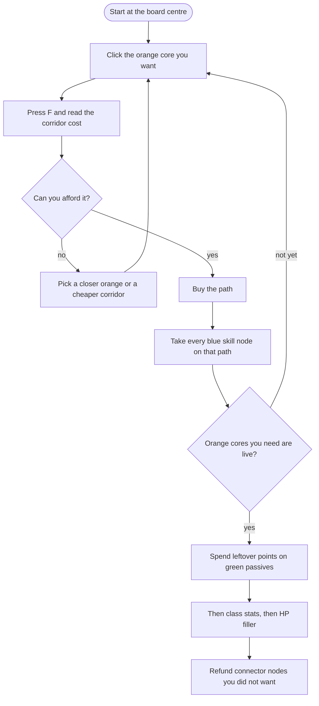
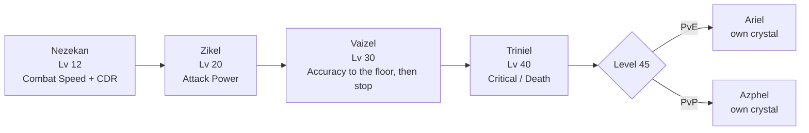
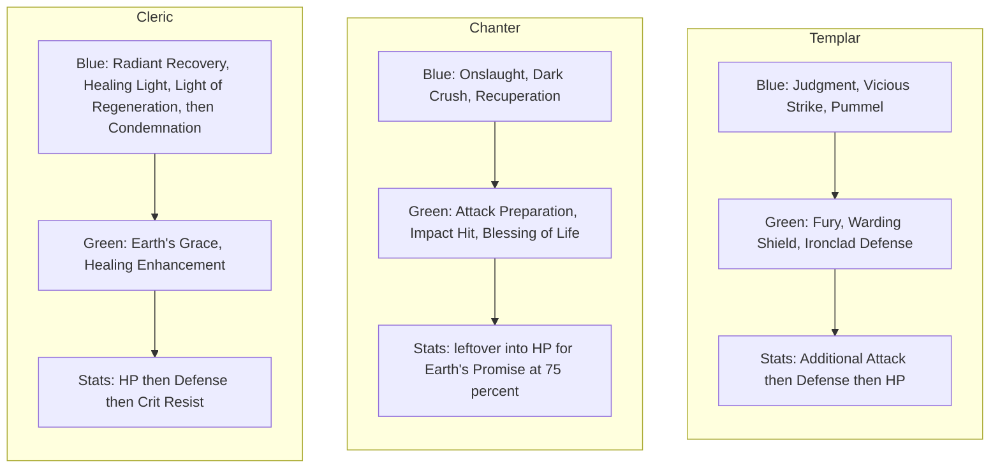

# Daevanion Boards

> **In one sentence:** Daevanion is the best-value progression system in Aion 2
> because every point you spend pays four ways at once — item level, Combat
> Power, the node's own stats, and sometimes a skill level — and the whole
> difficulty is that you will never have enough points to fill the boards, so
> routing is the entire game.

## Why it matters

The Daevanion system (데바니온, rendered **守護力** or "guardian power" in
Taiwanese builds) is a set of grid-shaped node boards, one per Empyrean Lord,
that you fill in with points bought from Daevanion Crystals. It looks like a
talent tree and behaves like one, but it is priced completely differently from
anything else in the game.

Here is why it dominates the early and mid game. **One Daevanion point spent
grants +1 item level.** That is a direct term in the item level formula
described in [[Item Level vs Combat Power]] — not a stat that contributes to
item level, but a component of it. Community measurement also puts each point at
roughly +1 Combat Power. On top of that you receive the node's actual stats, and
if the node is a skill node you receive a skill level as well. No other system in
Aion 2 pays on four axes from a single cheap currency.

The consequence is stark, and it is the thing to internalise: **if you are stuck
below an item level gate, Daevanion is almost always the cheapest way through
it.** Several hundred item level sitting in unspent crystals is common on
under-geared characters, because the boards are quiet, the UI is intimidating,
and the crystals accumulate in your inventory without nagging you.

The second thing to internalise is the supply problem. Through Korean Season 3,
players can obtain roughly **553 general Daevanion points**. Filling the four
general boards costs roughly **596 points before Chapter 1** and **840 after**.
**You cannot complete the boards.** Every guide that treats Daevanion as a
checklist is wrong; it is a routing problem with a hard budget, and points you
spend walking through nodes you did not want are permanently gone unless you pay
Kinah to unwind them.

## How it works

### The board roster: eight boards, and which are which

This is the question the vault flagged, and the answer is **eight boards in the
current Korean build**, which reconciles the "four plus two" and "eight" claims
cleanly: four arrive during levelling, two more at level 45, and two were added
later as Korean seasonal content.

| # | Board | Korean | Unlock | Purpose | Point currency |
| --- | --- | --- | --- | --- | --- |
| 1 | **Nezekan** | 네자칸 | **Level 12** | General | Daevanion Crystal |
| 2 | **Zikel** | 지켈 | **Level 20** | General | Daevanion Crystal |
| 3 | **Vaizel** | 바이젤 | **Level 30** | General | Daevanion Crystal |
| 4 | **Triniel** | 트리니엘 | **Level 40** | General | Daevanion Crystal |
| 5 | **Ariel** | 아리엘 | **Level 45** | **PvE / conquest specialised** | **Daevanion Crystal: Ariel** |
| 6 | **Azphel** | 아스펠 | **Level 45** | **PvP / battle specialised** | **Daevanion Crystal: Azphel** |
| 7 | **Marchutan** | 마르쿠탄 | KR **2026-02-25** (Season 2), level 45 | Seasonal specialised | Season 2 crystal, from *Fragment: Marchutan's Trace* |
| 8 | **Yustiel** | 유스티엘 | KR **2026-04-08** (Season 3), level 45 | Seasonal specialised | Season 3 crystal, from *Fragment: Yustiel's Trace* |

Reading the table:

**Boards 1–4 are the general boards.** They share one common currency, the plain
Daevanion Crystal, so points are fungible across them and the routing decision
spans all four at once. This is where the 553-versus-596 budget problem lives.

**Boards 5–6 are the level 45 specialised pair, and they are where PvE and PvP
split.** Each has its own dedicated crystal that the other cannot use — the
skill database exposes them internally as a *conquest* crystal for Ariel and a
*battle* crystal for Azphel, which is the clearest confirmation of the
PvE/PvP division. Ariel is the PvE board; Azphel is the PvP board and is
covered from the PvP side in [[PvP Boards and Transformations]].

**Boards 7–8 are seasonal additions** tied to specific Korean season content,
each with its own crystal sourced from a season dungeon. Marchutan's crystal
fragments come from the Sunken Temple of Life Transcendence content; Yustiel's
come from Hall of Illusion. Because their supply is welded to Season 2 and
Season 3 content, these are the two boards whose presence at global launch is
genuinely uncertain — see Global launch notes.

The early English sources that said "four basic plus two at level 45" were
accurate for the Korean launch build and simply predate the seasonal boards.
The sources saying eight are describing the current build. Both are right about
their own snapshot, which is why they appeared to conflict.

### Resolved: "Marchutan guardian power" is the Marchutan Daevanion board

**Confirmed.** These are one system reached through two translations, and the
evidence is direct rather than inferred.

The Taiwanese Bahamut patch-note thread for the 2026-02-25 update announces a
**「全新守護力面板『瑪爾庫坦』」** — literally "brand-new guardian power panel
'Marchutan'". 守護力 is the Traditional Chinese localisation of 데바니온
(Daevanion); 瑪爾庫坦 is the Traditional Chinese transliteration of 마르쿠탄
(Marchutan); and 面板 is "panel", the same word Taiwanese sources use for the
other Daevanion boards. The Korean patch for the same date adds the Marchutan
Daevanion board. Same date, same content, two localisations.

Two further pieces of confirmation:

- The Taiwanese thread for the **2026-04-08** update announces
  **「新增守護力『尤斯迪埃』」** — "added guardian power 'Yustiel'" — matching the
  Korean Season 3 addition of the Yustiel Daevanion board on the same date, and
  names the crystal items **守護力結晶：瑪爾庫坦** and **守護力結晶：艾瑞爾**,
  which are the Marchutan and Ariel Daevanion Crystals with 守護力結晶 standing
  in for 데바니온 결정.
- The official Taiwanese PURPLE Lounge ran an event titled
  **〈守護力瑪爾庫坦加速〉** — a "Guardian Power Marchutan acceleration" event,
  i.e. an official first-party page using "guardian power" and "Marchutan"
  together for the board.

So when an Arcana source refers to a "Marcutan guardian power" panel, it means
board 7 in the table above. There is no separate system. The romanisation drift
between Marchutan / Marcutan / Marukutan is transliteration noise from 마르쿠탄.
This is added to [[Glossary KR TW EN]] as a naming equivalence.

### Node types and point costs

Each board is a grid of nodes in four colours. The colour tells you what the
node gives; the tier tells you what it costs.

| Node | Colour | Gives | Notes |
| --- | --- | --- | --- |
| **Stat node** | white / grey | A flat stat | The bulk of every board. This is your item level and CP filler |
| **Active skill node** | **blue** | **+1 level to one active skill** | The skill layer. Choose which skill when you unlock it |
| **Passive skill node** | **green** | **+1 level to one passive skill** | Cheaper than spending Skill Points on passives |
| **Core node** | **orange** | A named special effect | The prizes. Sit at the far edges of the board |

**Point costs run 1, 2, 3 and 4 per node**, rising with the node's tier. Stat
nodes sit at the cheap end and orange core nodes at the expensive end. The exact
colour-to-cost mapping is not stated cleanly by any single source — treat the
1/2/3/4 range as solid and the per-colour assignment as medium confidence.

Two structural facts about node placement that drive all routing:

- **Orange core nodes are at the extremities.** You cannot cherry-pick them. To
  reach one you must buy every node along a path to it, which means a core node's
  true cost is its own 4 points plus the whole corridor leading there.
- **Blue and green skill nodes cap at +4 per skill.** A Korean class guide states
  the maximum Daevanion contribution to any one skill level as **+4**, which is
  the figure the arithmetic in [[Skills and Mastery Points]] and
  [[Arcana Cards and Types]] is built on: Skill Points to 10, Daevanion to 14,
  Arcana and gear from there.

There is one genuine unresolved conflict in the sources. The English Fextralife
wiki describes skill nodes on the Ariel and Azphel boards; the Korean games-press
launch coverage states that Ariel and Azphel are **larger boards containing only
stat nodes, with no skill nodes at all**. I lean toward the Korean source, both
because it is first-hand launch coverage and because it fits the design — the
specialised boards are the item-level and stat boards, while the skill levels
live on the four general boards. Do not plan a skill level around an Ariel node
until you have seen it yourself.

### Supply versus demand: the number that runs this note

| Quantity | Pre-Chapter-1 | Post-Chapter-1 |
| --- | --- | --- |
| Points to fill the four general boards | **~596** | **840** (210 per board) |
| General points obtainable | **553** | **709** (553 + 156) |
| Shortfall | **~43** | **131** |

The pre-Chapter-1 requirement of ~596 is my own summation from the per-board
node counts on the Fextralife snapshot dated 2026-01-08, so call it medium
confidence with the right order of magnitude. The 553 / 709 / 210 / 156 figures
come from a Korean routing guide that exists specifically to solve this budget
problem, and the fact that such guides are the most-read Daevanion posts on
Inven tells you how real the constraint is.

The separate, widely-quoted "**~400 points by level 45**" figure describes what
a player has *accumulated* by reaching the level cap, not what a board costs. It
comes from a boosting-shop article, so **confidence low**, but it is
directionally consistent with 553 being the eventual ceiling: most of your
points arrive from levelling, and the remaining ~150 come from the slower
achievement, dungeon and shop routes afterward.

So the practical model is: **you reach level 45 with roughly two-thirds of your
eventual point budget, and you can never fill everything.** Route deliberately.

### Path selection, the F key, and refunds

Nodes unlock **one adjacent square at a time**, north, south, east or west. You
cannot jump. This is why a bad route is expensive: reaching a node you want
through the wrong corridor buys you a column of stats you did not choose.

The client helps more than it appears to. **Click a target node and press F**,
and the interface auto-routes and purchases the whole path to it. This is the
single most useful piece of UI knowledge in the system, and it is not
signposted. Two Korean guides describe the same shortcut. Use it for planning
too — select a distant orange core node and read the total cost before
committing.

**Refunds cost Kinah.** You can remove nodes and recover the points, paying a
Kinah fee per node, which makes trimming a wasteful corridor possible but not
free. The Korean workflow that experienced players describe is: route to your
target orange nodes first, then walk back and refund the branches you took by
mistake, accepting the Kinah bill as the price of having a clean board.

The one exception is a Chapter 1 courtesy. When Chapter 1 expanded the four
general boards, NC granted **free resets on those four boards**, so Korean
players got one clean re-route. That is a Chapter 1 event, **not** a standing
feature, and it is not in the global launch build.

## Unlock and gates

| Gate | Board |
| --- | --- |
| Level 12 | Nezekan |
| Level 20 | Zikel |
| Level 30 | Vaizel |
| Level 40 | Triniel |
| Level 45 | **Ariel** (PvE) and **Azphel** (PvP) |
| Level 45 + Season 2 content *(roadmap)* | Marchutan |
| Level 45 + Season 3 content *(roadmap)* | Yustiel |
| Level 50 *(roadmap)* | Chapter 1 board expansion, +156 points of demand and free resets on boards 1–4 |

## Inputs: currencies, materials, sources

Points are not a drop. You obtain **crystals**, which convert into points.

| Currency | Sources |
| --- | --- |
| **Daevanion Crystal** (general, boards 1–4) | Character level-ups; region and zone quests; achievements; sealed dungeons; strongholds; the **Shugo Festa shop at 7 per character**; **Material Conversion from gathered Odyle**, per [[Odyle and Special Resources]] |
| **Daevanion Crystal: Ariel** | Mission quests; the Nightmare shop; Awakening Battle; the Abyss and Arena exchange shops; **the broker** |
| **Daevanion Crystal: Azphel** | PvP routes — Abyss and Arena shops, Awakening Battle; see [[PvP Boards and Transformations]] |
| Season crystals (Marchutan, Yustiel) | *Fragment: Marchutan's Trace* from Sunken Temple of Life; *Fragment: Yustiel's Trace* from Hall of Illusion; season shops |
| **Kinah** | Node refunds only. Not needed to buy points |

Two things worth pulling out of that table:

**The Ariel crystal is tradeable on the broker.** That is unusual and it is the
origin of the "**~150 million Kinah for a full board**" figure that circulates
in English SEO articles. Read correctly, that number is not a system cost — it
is an estimate of what it would cost to *buy* enough Ariel crystals off the
broker to fill the Ariel board at some past market price. It is therefore a
market snapshot, not a game constant, and it moves with the economy.
**Confidence low.** Do not budget against it. The only genuine Kinah cost in
this system is the node refund fee described above.

**Daevanion crystals are the most easily-missed currency in the game**, because
they arrive from content you do exactly once — region quests, achievements,
first clears — and then sit in your inventory. There is no weekly loop that
reminds you. Auditing your unspent crystals is worth doing at every item level
gate; see [[Daily and Weekly Loops]].

## Progression path

1. **Level 12–44.** Open each board as it unlocks and spend crystals the moment
   you get them. There is no reason to bank Daevanion crystals — the item level
   is worth more now than later. Push toward Nezekan's orange core nodes first;
   the Korean consensus prizes are **Combat Speed** and **Cooldown Reduction**,
   which are good on literally every class.
2. **Take blue active nodes for your two or three rotation skills early.** These
   are how you get past skill level 10, which Skill Points cannot do.
3. **Level 45.** Both specialised boards open, but do not open both. Pick the one
   matching what you actually play — **Ariel for PvE, Azphel for PvP** — because
   the crystals are separate and splitting them halves your progress on both.
4. **Around armour +12.** A Korean board-priority guide recommends starting Ariel
   only after your armour enhancement reaches roughly +12, on the grounds that
   gear enhancement returns more per unit of effort until then. Medium confidence,
   but the logic is sound and it matches the phase ordering in
   [[Progression Phases Roadmap]].
5. **Item level gates.** Whenever you are short of an entry requirement, audit
   unspent crystals before doing anything else. Points are +1 item level each and
   are the cheapest gate-passing currency in the game.
6. **Late.** Trim wasted corridors with Kinah refunds and re-route toward the
   orange cores you skipped.

## Priorities and breakpoints

- **Spend crystals immediately.** Banked crystals are item level you do not have.
- **Orange core nodes are the objective**; stat nodes are the road you take to
  get there. Price the whole corridor with the F-key preview before committing.
- **Blue nodes on rotation skills before green nodes on passives.** Actives carry
  the specialisation ladder; see [[Skills and Mastery Points]].
- **One specialised board, not two.** Ariel or Azphel, chosen by what you play.
- **Never plan to complete a board.** Supply is 553 and demand is 596 or more.

### Recommended routing by role

The honest framing: the boards are large, the good routes are class-specific,
and the current authority is your class's Inven board. What follows is the
role-level shape that Korean guides agree on, and it is a starting frame rather
than a solved route. **Confidence medium.**

| Role | Stat nodes to prioritise | Skill nodes | Orange cores to aim at |
| --- | --- | --- | --- |
| **Tank** | HP, Physical and Magic Defence, and the mitigation lines; Triniel's defensive cluster is the natural home | Green passive nodes on your mitigation passives, since a tank's passives are load-bearing in a way no other role's are | Cooldown Reduction first — your cooldowns are the party's survival — then any threat or block core |
| **Healer** | Magic Boost and cast-related lines, then HP | Blue nodes on your two most-pressed heals; the Cleric guidance on Inven is explicit that concentrating on the heals you actually spam beats breadth | **Cooldown Reduction** and **Combat Speed** on Nezekan, which together shorten every cast in your kit |
| **Damage** | Attack, Critical and the damage-amplification lines | Blue nodes on your rotation's two or three highest-frequency actives | **Combat Speed** first, then Cooldown Reduction; on the seasonal Marchutan board the reported cores are **Weapon Damage Amplification** and **Weapon Damage Resistance** |

Two caveats on that table. First, **stat node choices should follow the priority
order in [[Stat Reference]]** rather than being decided per board — the boards
are just another place to buy the same stats, and the same ranking applies.
Second, **Combat Speed and Cooldown Reduction are the universal picks** for all
three roles, which is why "rush Nezekan's cores" is the one piece of routing
advice that appears in essentially every Korean guide regardless of class.

Class-specific spend lists with graphs live on [[Templar Skills and Stigmas]],
[[Chanter Skills and Stigmas]] and [[Cleric Skills and Stigmas]]. The diagrams
below are the Season 1 shape those notes fill in.

### How to skill a board

Every board is a grid you walk one square at a time from the centre. Colour is
the whole decision. Orange cores sit at the edges, so their real cost is the
corridor, not the node.

Blue = +1 active skill level, cap **+4** per skill. Green = +1 passive level.
White = a stat. You cannot complete the four general boards on the Season 1
budget, so leftover filler is a choice, not a completionist pass.

### Board order at Season 1

**Launch Scale Test:** the Ariel branch was missing. Until Advance Access, treat
that split as **Azphel only**. Do not open Ariel and Azphel together if both
return. Marchutan and Yustiel are **roadmap**.

### What each class actually buys

The Cleric and the Chanter share one trap: **Earth's Grace** and **Earth's
Promise** both gate on holding your own HP at 75 percent or above, so HP nodes
are party damage, not selfish padding. See the class notes for the full
priority lists and the sources.

## Costs and math

| Figure | Value | Confidence |
| --- | --- | --- |
| Boards, current KR build | **8** | **High** |
| Boards at KR launch | 6 | High |
| General boards sharing one currency | 4 | High |
| Node cost range | **1 to 4 points** | High |
| Max Daevanion contribution to one skill level | **+4** | High |
| Points to fill four general boards, pre-Chapter-1 | ~596 | Medium (own summation) |
| Points to fill four general boards, post-Chapter-1 | **840** (210 each) | Medium |
| General points obtainable through Season 3 | **553** | Medium |
| General points obtainable post-Chapter-1 | **709** (553 + 156) | Medium |
| Points accumulated by level 45 | ~400 | **Low** (boosting-shop source) |
| Item level per point | **+1** | High |
| Combat Power per point | ~1, plus the node's stats | Medium |
| Shugo Festa crystals | 7 per character | Medium |
| "Full board for ~150,000,000 Kinah" | broker snapshot, not a system cost | **Low** |
| Node refund | Kinah fee per node | Medium |
| Free reset on the four general boards | Chapter 1 one-off event only | Medium |

## Traps and mistakes

- **Sitting on unspent crystals.** The most common and most costly error in the
  system, because nothing in the UI tells you off for it. Every crystal is item
  level you are choosing not to have.
- **Opening both Ariel and Azphel.** Separate currencies; splitting them means
  two half-finished boards instead of one good one.
- **Walking to an orange core without pricing the corridor.** Select the node,
  press F, read the cost, then decide.
- **Believing you can complete the boards.** You cannot. 553 available against
  596 or more required.
- **Budgeting against the 150 million Kinah figure.** It is a broker price
  snapshot from an SEO article, not a game constant.
- **Reading "~400 points by level 45" as a board cost.** It is an accumulation
  figure, and a low-confidence one.
- **Assuming free resets.** Free board resets were a one-time Chapter 1 courtesy
  and are not in the launch build; launch-era refunds cost Kinah per node.
- **Planning a build around Ariel or Azphel skill nodes.** The English wiki and
  the Korean launch coverage flatly disagree about whether those exist. Verify
  before you commit.

## Global launch notes

Against the **2026-10-05** global release. Season 1, gate ceiling around 3,800,
no Heroic gear.

**Launch Scale Test overrides the "six boards certain" line:**

- **Four general boards** (Nezekan, Zikel, Vaizel, Triniel) at 12/20/30/40:
  present. Percentage nodes **nerfed** (Combat Speed / CDR **1.5%**, Damage
  Boost **2.5%**; KR 2.5 / 2.5 / 5). Extra crystals purchasable in Shugo **and
  Nightmare** shops.
- **Ariel: absent.** No PvE specialised board, no tradable Ariel-point market
  (~1 million Kinah and 232 GS in KR). Largest anti-whale cut in the test.
- **Azphel: present.** Fragment-to-tile morphing **not observed**.
- Marchutan and Yustiel remain **roadmap**.
- Chapter 1 board expansion and free resets remain **out**.
- Kinah-cost node refunds, four colours, +1 item level per point: still the
  planning mechanics.

Do not route a launch character through Ariel. Do not copy KR percentage totals
when comparing Combat Power. See [[PvP Boards and Transformations]] and
[[Global Launch Differences]].

See [[Global Launch Differences]].

## Open questions

- [ ] **Are Marchutan and Yustiel in the global launch client, and what feeds
      them?** The decisive question. Settled by opening the Daevanion UI at level
      45 on launch day.
- [ ] **Do Ariel and Azphel contain skill nodes?** The English wiki says yes, the
      Korean launch coverage says stat nodes only. Settled by inspecting either
      board.
- [ ] Exact colour-to-cost mapping for the four node types. The 1–4 range is
      solid; which colour costs what is not cleanly stated anywhere.
- [ ] The exact pre-Chapter-1 point requirement per general board. My ~596 total
      is a summation from wiki node counts, not a published figure.
- [ ] What is the Kinah fee schedule for node refunds? Sources say "costs Kinah"
      without a formula. Does it scale with node tier, with board, or with the
      number of nodes removed?
- [ ] Complete orange core node lists per board. Only Nezekan's Combat Speed and
      Cooldown Reduction, and Marchutan's weapon damage pair, are named in the
      sources I found.
- [ ] Is the "+1 Combat Power per point" figure exact, or an approximation of the
      item level contribution feeding back into CP?
- [ ] Class-by-class routing for the remaining launch classes. Templar, Chanter
      and Cleric now have graphs in their skill notes; the other five do not.

## Sources

- [Daevanion Boards | Aion 2 Wiki](https://aion2.wiki.fextralife.com/Daevanion_Boards) — EN wiki, updated 2026-01-08 and therefore a pre-Chapter-1 snapshot. Supports: the six-board roster of the launch build with unlock levels 12 / 20 / 30 / 40 / 45 / 45; node point costs in the 1 to 4 range; per-board node counts used for the ~596-point pre-Chapter-1 estimate; orange core nodes sitting at the board extremities; and the centre-outward routing description. Also the source of the disputed claim that Ariel and Azphel contain skill nodes.
- [AION 2 Daevanion planner](https://aion2t.com/daevanion) and [AION 2 Daevanion board tool](https://aion2.app/daevanion) — EN interactive tools built on the NCSoft data. Support: the full eight-board roster including Marchutan and Yustiel, and their unlock levels — the primary confirmation that the board count is eight rather than six.
- [Daevanion boards — Gladiator](https://questlog.gg/aion-2/en/db/daevanion-boards/gladiator) and [Daevanion boards — Cleric](https://questlog.gg/aion-2/en/db/daevanion-boards/cleric) — EN game database derived from client data. Support: the point-currency assignment per board, with the four general boards sharing one Daevanion Crystal while Ariel uses a *conquest* crystal, Azphel a *battle* crystal, Marchutan a Season 2 crystal and Yustiel a Season 3 crystal. This currency split is the cleanest available evidence for the PvE / PvP / seasonal division.
- [아이온2 “스킬, 데바니온 세팅만 잘해도 만렙 수월하다”](https://www.gametoc.co.kr/news/articleView.html?idxno=104096) — KR games press, launch era. Supports: the six-board launch roster; the per-board composition of roughly 12 active and 10 passive skill nodes on the general boards; the claim that **Ariel and Azphel are larger boards with stat nodes only and no skill nodes**; and the dedicated per-board crystals for Ariel and Azphel.
- [데바니온 노드 4종 찍는 요령 (553+156=709p)](https://www.inven.co.kr/board/aion2/6444/2029) — KR Inven tips board, post-Chapter-1. Supports: 553 general points obtainable through Season 3; 156 further points added by Chapter 1 for 709 total; 210 points required per expanded general board and therefore 840 for all four; the resulting shortfall that makes completion impossible; and the node composition breakdown per board.
- [데바니온 노드 찍는 순서와 환불 요령](https://www.inven.co.kr/board/aion2/6444/2068) — KR Inven tips board. Supports: node point costs of 1 / 2 / 3 / 4 by tier; the route-first-then-refund-the-branches workflow; and the fact that refunds cost Kinah per node.
- [아이온2 데바니온 노드 완벽 가이드](https://loholynight.tistory.com/160) — KR blog. Supports: the one-square-at-a-time north/south/east/west unlock rule; the **F key** auto-routing to a selected target node; the figure of roughly 1 Combat Power per point spent; the crystal source list for the general and specialised boards; and the Marchutan board's orange core nodes being Weapon Damage Amplification and Weapon Damage Resistance.
- [\[AION2\] 아이온2 데바니온 확장 가이드](https://www.inven.co.kr/board/aion2/6493/201) — KR, NC-authored tips board on Inven, Chapter 1 era. Supports: the Chapter 1 expansion of the four general boards with **free resets granted on those four boards**; the increased point requirement after expansion; and the orange core node priorities per board, including Nezekan's Combat Speed and Cooldown Reduction.
- [(26/01/28 기준) ★ 치유성 가이드 ★](https://www.inven.co.kr/board/aion2/6452/657) — KR Inven Cleric board, 2026-01-28. Supports: the **maximum of +4 skill levels from Daevanion**, which anchors the chapter's skill-level arithmetic; the healer routing guidance toward cast and cooldown nodes; and the practical route-then-refund method.
- [아이온2 데바니온 보드 우선순위 정리 2026](https://alias007.tistory.com/755) — KR blog, Season 3 era. Supports: the board-opening priority order; the recommendation to begin Ariel only after armour enhancement reaches roughly +12; Yustiel's crystal fragments coming from Hall of Illusion; and reset costs being paid in Kinah.
- [아이온2 수호성 데바니온 스티그마 세팅](https://saiha.tistory.com/560904) — KR blog, Templar. Supports: the tank routing shape in the role table — defensive stat clusters and green passive nodes on mitigation passives.
- [아이온2 데바니온 결정 수급처 총정리](https://travous.tistory.com/2488) — KR blog. Supports: the crystal source lists, including the Shugo Festa shop providing 7 crystals per character, and the confirmation of six boards at the time of writing.
- [아이온2 데바니온 노드 자동 경로 팁](https://bokgoon.tistory.com/) — KR blog. Supports: the click-target-then-F auto-route shortcut, corroborating the loholynight description independently.
- [아이온2 아스펠 데바니온 45포인트 루트](https://www.inven.co.kr/board/aion2/6444/527) — KR Inven tips board. Supports: worked Azphel routing at a fixed point budget, used as the model for treating routing as a budget problem rather than a checklist.
- [아이온2 수호성 데바니온 노드 우선순위](https://www.inven.co.kr/board/aion2/6438/22546) — KR Inven Templar board. Supports: the tank node priority ordering summarised in the role table.
- [【討論】2/25更新公告內容](https://forum.gamer.com.tw/C.php?bsn=82913&snA=4240) — TW patch notes, Bahamut, 2026-02-25. **The primary source resolving the "guardian power" question.** Supports: the announcement of a 全新守護力面板「瑪爾庫坦」 — a brand-new "guardian power panel" named Marchutan — on the same date the Korean build added the Marchutan Daevanion board, establishing 守護力 as the Traditional Chinese localisation of 데바니온.
- [【討論】4/8更新公告內容](https://forum.gamer.com.tw/C.php?bsn=82913&snA=4240) — TW patch notes, Bahamut, 2026-04-08. Supports: 新增守護力「尤斯迪埃」 (added guardian power "Yustiel") matching the Korean Season 3 Yustiel board on the same date, and the crystal item names 守護力結晶：瑪爾庫坦 and 守護力結晶：艾瑞爾, which map 守護力結晶 onto 데바니온 결정 (Daevanion Crystal).
- [〈守護力瑪爾庫坦加速〉 event](https://lounge.plaync.com/feed/64496) — TW official, PURPLE Lounge. Supports: first-party Taiwanese use of "guardian power" together with "Marchutan" for the board, which removes any doubt that this is community shorthand.
- [《AION 2》技能強化攻略](https://www.ludens.com.tw/aion-2-skill-enhancement-mastery-stigma-guide-2025/) — TW, retrieved 2026-09-06. Supports: 德巴尼溫節點 (Daevanion nodes) as one of five growth routes, confirming that Taiwanese sources also use a direct transliteration alongside 守護力.
- [AION 2 守護力 配點攻略](https://sticweb.tw/) — TW guide site. Supports: the "reach the orange slab nodes first" routing philosophy and the active-skills-first ordering, corroborating the Korean guides from the Taiwanese side.
- [\[AION2\] 챕터원 데바니온 확장](https://lounge.plaync.com/feed/74513?country=KR&locale=ko-KR) — KR official, PURPLE Lounge, 2026-07-07. Supports: the Chapter 1 board expansion and the accompanying reset arrangements.
- [AION 2 Patch Notes archive](https://aion2hub.com/updates) — EN translations of official KR notes, retrieved 2026-09-06. Supports: the dates for the Marchutan board (2026-02-25) with *Fragment: Marchutan's Trace* from the Sunken Temple of Life, the Yustiel board (2026-04-08) with *Fragment: Yustiel's Trace*, and the Chapter 1 Daevanion expansion (2026-07-01).
- [아이온2 데바니온 포인트 상한 적용](https://www.j-castle.co.kr/724627) — KR, 2026-03-11. Supports: a cap being applied to obtainable Daevanion points, which is the mechanism behind the fixed 553 figure rather than an indefinite accumulation.
- [Aion 2 Daevanion Guide](https://www.aoeah.com/) — EN, a currency and boosting shop, **SEO content, confidence low, lead only**. Sole support for the "~400 Daevanion points by level 45" accumulation figure quoted in this note. Directionally consistent with the sourced 553 ceiling but not independently corroborated.
- [Aion 2 Daevanion board cost estimate](https://www.u4n.com/) — EN, a Kinah shop, **SEO content, confidence low, lead only**. Sole support for the "~150,000,000 Kinah to fill a board" figure, which is a broker market estimate for Ariel crystals rather than a system cost. Flagged in the note as unreliable and not to be budgeted against.
- [AION 2 Daevanion talent planner](https://talentbuilds.com/aion-2) — EN tool. Supports: node refunds costing Kinah, and the general grid-adjacency routing model.

## Related notes

[[Skills and Talents]] · [[Skills and Mastery Points]] · [[Stigmas]] ·
[[Odyle and Special Resources]] · [[PvP Boards and Transformations]] ·
[[Item Level vs Combat Power]] · [[Stat Reference]] ·
[[Progression Phases Roadmap]] · [[Arcana Cards and Types]] ·
[[Abyss Points and Ranks]] · [[Arenas Sieges and Seasons]] ·
[[Garrisons and Sealed Dungeons]] · [[Titles and Achievements]] ·
[[Daily and Weekly Loops]] · [[Currencies and Economy]] ·
[[Class Playbooks]] · [[Templar Skills and Stigmas]] ·
[[Chanter Skills and Stigmas]] · [[Cleric Skills and Stigmas]] ·
[[Glossary KR TW EN]] ·
[[Season 1 System Availability]] · [[Global Launch Differences]] · [[Home]]
