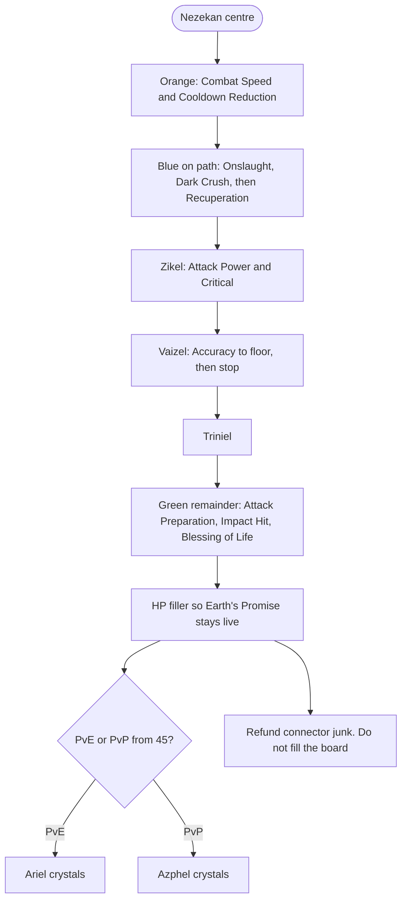

# Chanter Skills and Stigmas

> **In one sentence:** the Chanter's rotation is a melee **autoattack cancel
> loop** on left click, the class's reason to exist in a party is
> `Undefeated Mantra` at stigma level 20, and on skill level you only need
> **two** actives at 20.

## Why it matters

Two facts shape Chanter play more than any gear choice.

**The rotation is not a rotation.** Korean Chanters play **평캔** — *normal-
attack cancel* — weaving skills into autoattack recovery frames so both fire. One
Korean guide measures the autoattack cancel loop at roughly **50 percent more
damage** than pressing `Onslaught` alone. That is why Combat Speed is the
signature stat and why the class is unplayable at range.

**The skill level ceiling is low.** Where a damage dealer needs four or five
actives at level 20, the Chanter needs **two**: `Onslaught` and `Dark Crush`.
Everything else is fine at 12 or 16. That frees enormous Arcana and gear budget
for passives — the class's main planning consequence; see [[Chanter Support Systems]].

Systems live in [[Stigmas]] and [[Daevanion Boards]]; this sheet is only what a
Chanter should pick. The plan it fits: [[Chanter BiS Roadmap]].

**Skill names below are live global English client strings** (AION 2 Hub and
Questlog, retrieved 2026-09-17). Korean stays in parentheses so KR guides remain
searchable. Patch notes and older English pages say `Storm Smash` instead of
`Storm Chain` and `Piercing Smash` instead of `Piercing Strike`. Full mapping in
[[Glossary KR TW EN]] and [[Class Playbooks]].

## How it works

### The core loop

Chanter damage comes from a small, dense melee kit:

- **`Onslaught` (격파쇄)** — left-click autoattack chain. Live client chain names
  are `Resonance Crush` and `Bolt Crush`; with the fifth specialisation the fourth
  hit is **`Storm Chain` (폭풍쇄)**, reported as **the third-largest share of a
  Chanter's total damage**. Also restores MP and drains life with the right spec.
  This one skill explains why mana is rarely a problem and why HP can hold the
  75% line for `Earth's Promise`.
- **`Incandescent Blow` (백열격)** — right click. Primary cancel partner; chains into
  `Bursting Blow`.
- **`Impactful Crush` (타격쇄) → `Crushing Blow` (파산격)** — two-hit chain that puts
  the target in a control state.
- **`Dark Crush` (암격쇄) → `Piercing Strike` (관통쇄)** — only on a target in a
  **control state**; `Impactful Crush` comes first. Carries Guaranteed Critical
  specialisation (~10% on the skill), bypassing the ~80% crit ceiling.
- **`Rushing Smash` (돌진 격파)** — 20-meter gap closer. Opener — and proof the class
  is designed for melee.
- **`Spinning Strike` (회전격)** — AoE; since patch 2026-04-29 also a **self-buff
  with critical damage amplification and healing amplification**.
- **`Heat Wave Blow` (열파격)** and **`Tremor Crush` (진동쇄)** — reactive, from block
  and dodge respectively.
- **`Wave Blow` (파동격)** — vs. stunned target; roughly **−20% damage amplification**
  on mid-bosses and above. Group mitigation disguised as damage.
- **`Gust Rampage` (질풍 난무)** — burst in the groggy bar phase.
- **`Recuperation` (쾌유의 주문)** — main heal, 15 s base, scales with max HP.
- **`Defiance` (충격 해제)** — CC break. Non-negotiable in PvP.

Passives that matter:

| Passive | KR | Effect |
| --- | --- | --- |
| `Attack Preparation` | 공격 준비 | Damage Amplification, defense and accuracy. **Reworked 2026-01-21 from attack % to Damage Amplification** — older guides describe a different skill |
| `Impact Hit` | 충격 적중 | Shock accuracy and **Smite chance** |
| `Protection Circle` | 보호진 | Stacks on hits (0.5 s internal CD); at ten stacks **party shield 10 s**. Preventive mitigation |
| `Earth's Promise` | 대지의 약속 | Shreds boss damage resistance **for the whole party** — only while **your HP ≥75%** |
| `Wind's Promise` | 바람의 약속 | **+0.7% critical damage amplification per level**, party-wide |
| `Blessing of Life` | 생명의 축복 | Max HP and **Healing Amplification**. Only scaler for your heals |
| `Inspiring Spell` | 고취의 주문 | Critical **and Perfect**. Why Perfect is a real Chanter stat |
| `Crossguard` | 십자 방어 | Flat **+200 Block** and heal on block. Keystone of the bruiser build |
| `Raging Spell` | 격노의 주문 | Bonus damage vs. shock targets |
| `Survival Willpower` | 생존 의지 | Status effect resist. PvP |

### Skill point economy

Actives open **specialisation slots at levels 8, 12, 16 and 20**. Skill Points
plus a full Daevanion board reach about **14**; **16 costs +2 and 20 costs +6**
from Arcana cards and gear imprints. Passives cap at **10** from Skill Points,
with up to **22 more** from gear, Arcana and Daevanion nodes.

Practical rule: **do not chase 16 and 20 before final gear**, because skill levels
bind to items you still replace. A Korean guide states this explicitly.

## Level build, levels 1 to 45

Optimised for clear speed and not needing a healer.

**Active order.**

1. **`Onslaught`** — first and hardest. Basic attack, MP battery and with life-
   drain spec your sustain. **Specialisation 5 (`Storm Chain`, fourth hit) as soon
   as available** — mandatory.
2. **`Impactful Crush` → `Dark Crush`** — control then punishment. Single-target
   damage until endgame.
3. **`Recuperation`** — **at least level 12**. 12 s cooldown and max-HP-proportional
   healing carries elites solo and bad groups.
4. **`Spinning Strike`** — AoE. Mob packs matter while levelling; self-buff makes
   it worthwhile later.
5. **`Rushing Smash`** — cheap and halves run time between packs.

**Passive order.** `Attack Preparation` → `Impact Hit` → `Blessing of Life` →
`Protection Circle`. First two are damage; third is self-sustain while levelling.

**Stigma order while levelling** (slots via quest between 20 and 35 — long before
four): every early shard into **`Undefeated Mantra`**. Nothing competes.

**Ignore until 45.** `Heat Wave Blow` and `Tremor Crush`. `Gust Rampage`. `Wave
Blow` specialisations. Anything targeted at 16 or 20.

## Endgame build, Season 1

### Season 1 constraints

Korean guides after March 2026 assume five or six stigma slots and a cap above 20.
**Global Season 1 has four slots and cap 20.** Korea launched with four; fifth
2026-03-25, sixth with level 50. NC Purple Lounge stigma explainer: max four
equipped.

Also missing or likely missing at launch: **`Crushing Strike` (분쇄격)** 2025-12-17,
**`Barrier Spell` (결계의 주문)** later, and the seven-second `Dark Crush` window from
`Marchutan's Wrath` from 2026-03-04. Do not build a rotation that depends on them.

### Actives — target levels and specialisations (8 / 12 / 16 / 20)

Specialisation slots at **8, 12, 16 and 20**. Skill Points + full Daevanion ~**14**;
**16 = +2, 20 = +6** from Arcana and gear. Passives have no specialisation ladder.
Numbering follows the Korean board: **"20 (2, 3, 5)" = level 20 with specialisations
2, 3 and 5.**

PvE picks: Inven Chanter guide August 2026 (Hagoo). A second video differs on
some numbers; on conflict Hagoo wins, alternative in the fallback column.

| Skill | Target | Specialisations (8/12/16/20) | What each buys | Fallback under 20 |
| --- | --- | --- | --- | --- |
| **`Onslaught`** (격파쇄) | **20** | **(2, 3, 5)** | 2: Lifesteal (holds 75% for `Earth's Promise`). 3: Multi-Hit. **5: `Storm Chain`, fourth hit** — third-largest damage share. Skip 1 (MP) and 4 (Spinning Strike CDR) unless you actively play `Spinning Strike` | **(2, 5)** until 20 |
| **`Dark Crush`** (암격쇄) | **20** | **(1, 3, 5)** or **(3, 4, 5)** | Control target only. Guaranteed Critical ~10% on skill, bypasses 80% crit ceiling. Cooldown delete enables repeat in loop. Trio: Guaranteed Crit + `Piercing Strike` (or Lifesteal) + Cooldown Delete | Piercing Strike + Cooldown Delete |
| **`Incandescent Blow`** (백열격) | **16**, 20 if budget | 16 **(3, 5)**; 20 **(3, 4, 5)** | 3: more damage vs. fewer targets. 5: ignore Block/Evasion + Multi-Hit (~16–20% more on skill). 4: accuracy shred. Skip 1 (MP). Cancel partner; loop ~50% over Onslaught alone | **(3, 5)** |
| **`Recuperation`** (쾌유의 주문) | **16**, 20 as sole healer | 12 **(1, 4)**; 20 **(1, 4, 5)** | 1: extra cast. 4: 10% max-HP heal. 5: cooldown −3 s | **(1, 4)** at 12 |
| **`Wave Blow`** (파동격) | **16** | **(4, 5)** | 4: **−20% damage amplification** from mid-boss. 5: cooldown. Spec 3 reworked 2026-01-07, not a PvE pick | **(4)** at 12 |
| **`Gust Rampage`** (질풍 난무) | **16** | **(4, 5)** | Groggy bar only. Multi-Hit + all-skill CDR, scales with combat speed (~11–14 s). Skip MP recover. 20 would add spec 3 | Multi-Hit + move-cast at 12 |
| **`Impactful Crush`** (타격쇄) | **12** | AoE *or* move-cast, plus `Crushing Blow` if you want the chain | Sets control for `Dark Crush`. Spec 4 optional, depends on right-click order | — |
| **`Rushing Smash`** (돌진 격파) | **12** | **(3, 4)** | 4: kill reset. 16: ignore Block/Evasion. 1 PvP shock-resist shred. 3 (50% `Heat Wave Blow`) skippable in PvE | — |
| **`Spinning Strike`** (회전격) | **12** | **(1, 2)** | 1: cooldown. 2: skill speed. Self-buff since 2026-04-29. Do not take Onslaught spec 4 for this | — |
| **`Heat Wave Blow`** (열파격) | 12 | Multi-target damage + ignore Block/Evasion | Block-triggered. Skip 16 spec (25% reset on block) in PvE | — |
| **`Tremor Crush`** (진동쇄) | 12 | Stamina recover + range | Dodge gap closer. 16 is PvP | — |
| **`Defiance`** (충격 해제) | 12 | Stamina recover + HP recover | CC break. PvP mandatory, PvE comfort | — |

**Short list:** two skills at 20 (`Onslaught`, `Dark Crush`), four at 16, rest at
12. Much cheaper than a damage dealer; both level-20 skills sit in the **Parchment**
Arcana pool — small enough to farm deliberately.

### Passive targets

| Passive | Target | Why |
| --- | --- | --- |
| `Attack Preparation` | as high as gear allows, to 30 | Damage Amplification, accuracy, defense. Endgame Chanters push this and `Impact Hit` to 30 |
| `Impact Hit` | as high as gear allows, to 30 | Smite chance; Chanter **0.3% Smite per passive level** — best rate of any class |
| `Protection Circle` | high | Ten-stack party shield covers mitigation heals cannot |
| `Earth's Promise` | high | Party damage-resistance shred. **Competes** with `Inspiring Spell` for the same board slot; no consensus |
| `Blessing of Life` | party-dependent | **Only** heal scaler. High as sole healer, moderate otherwise |
| `Wind's Promise` | moderate | 0.7% critical damage amplification per level, party-wide |
| `Inspiring Spell` | moderate | Critical and Perfect. Rises in endgame with max-attack-power builds |
| `Crossguard` | low, or high in block build | +200 flat Block and heal on block |

### Stigma loadouts for four slots

**PvE, standard (Cleric in party).**

| Slot | Stigma | KR | Role |
| --- | --- | --- | --- |
| 1 | **`Undefeated Mantra`** | 불패의 진언 | At 20: party damage amplification, damage resistance, critical, accuracy, critical damage amplification **and +5% Smite** together. Guides call this why the class exists. Level first, take to 20, never unequip |
| 2 | **`Power of the Storm`** | 질풍의 권능 | Party **combat speed** and party attack buff on stigma level 20 specialisation. Same stat axis as your best personal stat |
| 3 | **`Sprint Mantra`** | 질주의 진언 | Party movement speed and utility. Level 10 enough — stigma level 15 spec "+100% HP Recovery" affects **only that skill's recovery, not your heals** |
| 4 | **Flex** | see below | Slot that defines your night |

**Flex options:**

- **`Healing Touch` (쾌유의 손길)** — heal plus dispel, 30 s CD. **Take without
  Cleric.** Often true in four-player Season 1 groups.
- **`Impeding Authority` (차단의 권능)** — party shield, long CD. Progression pick for
  unknown mechanics.
- **`Focused Defense` (집중 방어)** — active block. Frontal telegraphed bosses.
- **`Obliterate` (멸화)** — groggy damage. Parse pick for farm content you already
  clear.
- **`Guardian Blessing` (수호의 축복)** — targeted def buff when one person keeps dying.

**PvP.**

| Slot | Stigma | KR | Role |
| --- | --- | --- | --- |
| 1 | `Undefeated Mantra` | 불패의 진언 | Still the best thing you have |
| 2 | `Sprint Mantra` | 질주의 진언 | Movement decides open-world PvP and Abyss |
| 3 | `Ensnaring Mark` | 결박의 낙인 | Control. Without lock you cannot set up `Dark Crush` |
| 4 | `Focused Defense` **or** `Assault Shock` (강습 충격) | 집중 방어 / 강습 충격 | Survive or commit |

Mind `Defiance` uptime; **status effect resistance and PvP stats rise sharply in
priority** in PvP — see [[Stat Reference]].

**Rule that catches many players: mantra buffs do not stack between Chanters.** Only
the highest level applies. If the party already runs Undefeated Mantra 20 and yours
is 10, you contribute **nothing** — put something else in the slot.

### Stigma level order and cost

Cost (Korean breakdown): roughly **5 shards to 5, 10 more to 10, 20 more to 15,
40 more to 20** — about **75 per stigma to 20**, four slots at cap **~300 stigma
shards**. Specialisations at 5, 10, 15 and 20 — early levels disproportionately
valuable.

Order:

1. `Undefeated Mantra` to **5** (first specialisation).
2. `Power of the Storm` to **5**.
3. `Sprint Mantra` to **5**.
4. Flex pick to **5**.
5. **`Undefeated Mantra` to 20.** Do not split shards before this.
6. `Power of the Storm` to **20**.
7. `Sprint Mantra` to **10**, then stop.
8. Flex to 10, then 20.

Shards from **Abyss shop for Abyss Points**, **Rift of Time and Space** quests and
weekly Ascension Trial. See [[Stigmas]].

## Daevanion board routing

Seven boards. Endgame Chanters use all, but order matters while crystals are
scarce. Method aligned across Korean sources:

**On each board take orange (main stat) and blue (+1 skill level) first, then green
(+1 passive level); refund low-priority connector nodes once the path is set.**
Node refunds exist — use them.

| Order | Board | Lord | Gives | Why this position for Chanter |
| --- | --- | --- | --- | --- |
| 1 | **Nezekan** | Justice | **Combat Speed and Cooldown Reduction** | Universal first board; here doubly right: combat speed is signature stat, CDR is buff uptime. Both top stats on one board |
| 2 | **Zikel** | Destruction | **Attack Power and Critical** | Raw offense. Chanter carries real damage; crit feeds `Dark Crush` |
| 3 | **Vaizel** | Freedom | **Accuracy** | Only **to accuracy floor** for your content, then stop. Accuracy is prerequisite, not scaler |
| 4 | **Triniel** | Death | Utility-offense mix | Death is Chanter-relevant lord per ranker bracelet data |
| 5–7 | **Ariel, Azphel, Kaisinel** | Life, Darkness, Illusion | HP/healing; PvP; **Cooldown Reduction** | Own crystal types. **Kaisinel/Illusion higher for Chanter than most classes** — CDR is buff uptime |

**Which nodes specifically:**

- **Blue (skill level):** `Onslaught` and `Dark Crush` first — the two skills that
  need 20; every free level saves gear spend. Then `Recuperation`.
- **Green (passive):** `Attack Preparation`, `Impact Hit`, `Blessing of Life`. Four
  of the 22 gear passive levels — the cheapest four.
- **Skip:** `Incandescent Blow` nodes if you dark-crush auto-cancel; `Spinning Strike`
  outside AoE farm.
- **Remainder:** into **HP**. One KR guide cites **19,500 HP** as survivability target
  ~1,800 KR item level; single source, medium confidence, fits `Earth's Promise` 75%
  rule.

Season 1 graph: Kaisinel and later season boards are roadmap; at launch four general
boards, then Ariel or Azphel. Colour rules in [[Daevanion Boards]].

### In-game macro (PvE)

Full setup: [[In-Game Macros and Hotbar Lines#Chanter (호법성)]].

| Hotbar column | Stack **bottom → top** |
| --- | --- |
| **Crush line** | **`Dark Crush`** → **`Spinning Strike`** → **`Incandescent Blow`** |
| **Second step** | Whole column bound to **`Onslaught`** (one skill per column) |

**Macro (2 steps, 10 ms):** Crush column → **`Onslaught`** column. **Hold Macro + LMB**
for auto-cancel (평캔). [Inven macro guide](https://www.inven.co.kr/board/aion2/6451/7090).

**Manual only:** **`Impactful Crush`** / control setup before **`Dark Crush`**; before
level 45, openers when **`Dark Crush`** is on cooldown; **`Undefeated Mantra`**, **`Power
of the Storm`**, **`Recuperation`**, **`Healing Touch`**. **Never** put mantras in the
macro — toggles turn **off** on the second press.

## Priorities and breakpoints

| Breakpoint | Value | Benefit |
| --- | --- | --- |
| `Onslaught` spec 5 | as soon as available | `Storm Chain`, fourth hit, third-largest damage source |
| `Undefeated Mantra` | **stigma level 20** | Six party buffs incl. +5% Smite. Class justification |
| `Power of the Storm` | stigma level 20 | Party combat speed plus party attack buff |
| `Recuperation` | 12 while levelling, **16** endgame, 20 as sole healer | ~12 s CD, larger max-HP heal |
| `Wave Blow` | level 16 | −20% damage amplification from mid-boss |
| `Onslaught` and `Dark Crush` | **level 20 each** | Only actives that truly need it |
| Passives | to 30 on `Attack Preparation` and `Impact Hit` | 0.3% Smite per level plus damage amplification |
| Combat Speed | 82.5%, then 90.5% | Break speed caps on `Dark Crush` then `Piercing Strike`; 18 → 20 → 22 hits per test window |
| Stigma Shards | ~75 per stigma, ~300 total | Four slots at Season 1 cap 20 |
| Nezekan board | finish first | Combat speed and cooldown reduction together |
| Own HP | **maintain 75%** | `Earth's Promise` stays active for the party |

## Traps and mistakes

- **Standing off and pressing `Dark Crush`.** Most common Chanter mistake. Board post:
  if you do that, "you are not a Chanter." `Storm Chain` is top-three damage;
  `Protection Circle` only stacks when your attacks land.
- **Believing Sprint Mantra stigma level 15 buffs your heals.** It buffs only that
  skill's recovery. `Blessing of Life` is the only heal scaler.
- **Splitting shards evenly across four stigmas.** **`Undefeated Mantra` to 20 first.**
  No comparison.
- **Second Chanter's mantra at lower level.** Mantras do not stack. Change flex slot.
- **Buying skill 16/20 on gear you will replace.** Wait until the set is final.
- **Skipping `Impactful Crush`.** `Dark Crush` needs control state.
- **Letting HP sit under 75%.** Lifesteal spec on `Onslaught` exists for this.
- **Reading undated KR guides.** Class reworked repeatedly: `Attack Preparation`
  2026-01-21; `Undefeated Mantra` −5% 2026-01-21; `Wave Blow` spec 3 2026-01-07;
  `Spinning Strike` self-buff 2026-04-29; `Marchutan's Wrath` as `Dark Crush` trigger
  2026-03-04; large rework 2026-08-26. December and June guides describe different
  classes.
- **Macro without checking rules.** Korean auto-cancel often uses the **in-game skill
  macro** on left click — client feature, not third-party — but verify globally first.

## Global launch notes

- **Four stigma slots, cap 20.** Most important adjustment in this sheet. Current KR
  loadouts use five or six. Ignore them; use four-slot tables above.
- **`Crushing Strike`, `Barrier Spell` and Marchutan `Dark Crush` window are post-
  launch** — treat as absent.
- **Class balance unknown.** Largest KR rework after Chapter 1: 2026-08-26. Global
  ships a snapshot. Direction from endgame Chanters: **away from damage, toward buff,
  debuff and healing**.
- **Combat-speed breakpoints measured with mechanics likely missing at launch.**
  Numbers probably survive; context may not. Re-measure.
- **Skill names = live global English strings.** Korean beside them for old guides.
- **Party size.** NC: four-player dungeons globally like KR launch. Four-player without
  Cleric more likely → `Healing Touch` flex and `Blessing of Life` on gear more valuable.

## Open questions

- [ ] Exact Season 1 stigma pool globally. NC ~twelve per class; Chanter list not found.
- [ ] Global four or five stigma slots at launch.
- [ ] Whether 82.5% and 90.5% combat speed hold without `Marchutan's Wrath`. Repeat hit
      counts day one.
- [ ] `Earth's Promise` vs. `Inspiring Spell` for contested passive slot.
- [ ] Whether in-game skill macro exists on Global client.
- [ ] Exact Daevanion node maps per board for Chanter.
- [ ] Whether `Spinning Strike` self-buff (2026-04-29) is in launch build.
- [ ] Front vs. rear damage amplification for Chanter — positioning, reactive skills.

## Sources

- [AION 2 Hub — Chanter](https://aion2hub.com/classes/chanter) — live global client skill list, retrieved 2026-09-17. Source of every English skill name in this note, including Onslaught / Resonance Crush / Bolt Crush / Storm Chain, Recuperation, Undefeated Mantra, Earth's Promise and Healing Touch.
- [Questlog — Chanter active skills](https://questlog.gg/aion-2/en/db/skills/chanter/active) — EN skill database, retrieved 2026-09-17. Cross-check of Hub names; Onslaught lists Storm Chain as a specialty.
- [\[26.08.05\] 호법성 PVE 종합 가이드](https://www.inven.co.kr/board/aion2/6451/116) — KR, Inven Chanter board, posted 2025-11-24 and maintained to 2026-08-05, read 2026-09-06. Author at 897k CP. **Primary source for this note.** Active and passive priority ordering with per-skill specialisation picks; autoattack cancel (평캔) and in-game macro; `Storm Chain` as third-largest damage share; `Undefeated Mantra` level-20 effects including +5% Smite; mantra non-stacking; `Protection Circle` 0.5 s internal CD and ten-stack party shield; `Wind's Promise` 0.7% critical damage amplification per level; `Wave Blow` −20% damage amplification; `Dark Crush` guaranteed critical ~10% and ~80% crit ceiling; `Sprint Mantra` level-15 spec heal correction; patch log; seven Daevanion boards.
- [아이온2 호법성 PVP 스킬트리, 셋팅등 종합가이드](https://cvmaxlimbo.tistory.com/141) — KR blog, February 2026, read 2026-09-06. Closest Season 1 state: **four-slot** loadout, PvP variant, Incandescent cancel ~50% over Onslaught alone, passive ordering, `Earth's Promise` 75% HP.
- [560+ 호법의 강의 및 방향성](https://www.inven.co.kr/board/aion2/6451/11651) — KR, Inven Chanter board, read 2026-09-06. Melee requirement; only Onslaught and Dark Crush need level 20; passives to 30; Parchment pool observation.
- [재측정) 암격쇄/관통쇄 전속캡에 대한 실험 2](https://www.inven.co.kr/board/aion2/6451/14994) and [earlier thread](https://www.inven.co.kr/board/aion2/6451/11904) — KR, Inven, read 2026-09-06. Combat speed breakpoints, hit counts, method, hardware/latency caveat.
- [호법 PVE 간단 가이드 (평캔 매크로사용)](https://www.inven.co.kr/board/aion2/6451/7090) — KR, Inven, read 2026-09-06. Minimal four-stigma loadout; in-game macro on left click.
- [✨ PvE 호법성 스킬트리 & 공략: "치유성 없어도 됨" 힐러 대체 빌드](https://harukyu.tistory.com/63) — KR blog, read 2026-09-06. No-Cleric variant with `Healing Touch` and heavier `Recuperation`.
- [\[아이온2\] 호법성 스킬트리 상향 후 최신 버전](https://vortexgaming.io/postdetail/615843) — EN/KR translation, read 2026-09-06. `Recuperation` at 16, `Gust Rampage` level-16 CDR spec, do not chase 16/20 before final gear.
- [\[AION2\] 아이온2 스티그마 시스템 완전 정복](https://lounge.plaync.com/feed/51924?country=KR&locale=ko-KR) — **NC official** Purple Lounge, 2025-12-22, read 2026-09-06. ~twelve stigmas per class; **max four equipped**; slots from quest levels 20–35.
- [아이온2 "3월 25일에 클래스별 신규 스티그마 추가한다"](https://www.gametoc.co.kr/news/articleView.html?idxno=107107) — KR press, March 2026, read 2026-09-06. Four-to-five slot expansion.
- [\[아이온2\] 스티그마 올리는 방법](https://madimi.tistory.com/58) — KR blog, read 2026-09-06. Shard costs 5/10/20/40 totalling ~75 to level 20; specs at 5/10/15/20.
- [\[아이온2\] 데바니온 우선순위](https://alias007.tistory.com/755) — KR blog, read 2026-09-06. Nezekan first for combat speed and CDR, then Zikel.
- [\[아이온2\] 치유성 아르카나 · 데바니온 정리](https://www.inven.co.kr/board/aion2/6452/657) — KR, Inven Cleric board, read 2026-09-06. Orange/blue first then green with refunds — cross-applies to support classes.
- [아이온2 노드 최적화 도구](https://aion2scam.com/page_node/) — KR tool, read 2026-09-06. Per-class Daevanion optimisation exists for Chanter.
- ['강타' 세팅 가이드](https://www.inven.co.kr/board/aion2/6444/1138) — KR, Inven tips, read 2026-09-06. Chanter **0.3% Smite per passive level**; 22-level gear budget; `Undefeated Mantra` +5% Smite.
- [《AION2》護法星技能點法與副本定位攻略](http://a.ptt543.com/thread-447611-1-1.html) — TW, read 2026-09-06. Skill ordering; class passive levels on gear.
- [《AION2》護法星入門攻略](https://sticweb.tw/aion2-%e8%ad%b7%e6%b3%95%e6%98%9f%e5%85%a5%e9%96%80%e6%94%bb%e7%95%a5/) — TW, read 2026-09-06. Season 1 stigma advice; cannot sustain continuous healing.
- [《永恒之塔2》PVE向上班族护法星小小心得](http://news.17173.com/content/12222025/164037427.shtml) — CN, 2025-12-22, read 2026-09-06. Base cooldowns — emergency-support evidence; promotes CDR.
- [아이온2 호법성 빌드 완전 공략 (1800 레벨 기준)](https://game.savetip.co.kr/%ec%95%84%ec%9d%b4%ec%98%a82-%ed%98%b8%eb%b2%95%ec%84%b1-%eb%b9%8c%eb%93%9c-%ec%99%84%ec%a0%84-%ea%b3%b5%eb%9e%5-%ec%8a%a4%ed%82%ac%ed%8a%b8%eb%a6%ac-%ec%8a%a4%ed%8b%b0%ea%b7%b8%eb%a7%88-%eb%8d%b0/) — KR blog, read 2026-09-06. 19,500 HP target; leftover Daevanion into HP.
- Author demonstration footage linked from Inven guide — listed for re-verification, **not independently reviewed**: auto-cancel [theory](https://www.youtube.com/watch?v=liqn9iQrj7M) and [method](https://www.youtube.com/watch?v=0D_NQ-QzNdg), [macro setup](https://www.youtube.com/watch?v=s1V95_DJgQs), [solo Nightmare Kaisinel stage 10](https://www.youtube.com/watch?v=_1S-5JZdgyI), [Chalice of Muspel second named with no Cleric](https://www.youtube.com/watch?v=wvkgeSN_QPY).

## Related notes

[[Chanter BiS Roadmap]] · [[Chanter Gear and Slots]] ·
[[Chanter Support Systems]] · [[In-Game Macros and Hotbar Lines]] ·
[[Templar BiS Roadmap]] · [[Stigmas]] ·
[[Daevanion Boards]] · [[Stat Reference]] · [[Item Level vs Combat Power]] ·
[[Arcana Cards and Types]] · [[Arcana Sets and Meta]] ·
[[Soul Imprint and Soul Binding]] · [[Dungeons and Raids]] ·
[[Global Launch Differences]] · [[Home]]
