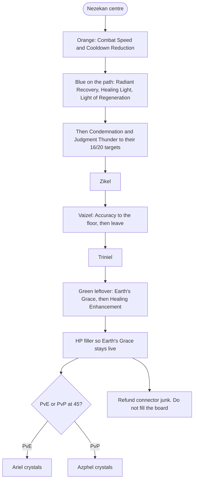

# Cleric Skills and Stigmas

> **In one sentence:** the Cleric is the only dedicated healer, its job is
> **keeping party buffs and boss debuffs live** while `Radiant Recovery` and
> `Healing Light` catch the spikes, and at Season 1 you do it with four stigma
> slots rather than the five every later Korean guide assumes.

## Why it matters

A four-player Season 1 dungeon is much likelier to need a real healer than a
five-player Korean endgame group. The Chanter can cover a night without you;
it cannot cover a wipe-heavy progression boss the way `Summon Resurrection`
and `Radiant Recovery` can.

Skill investment is still the densest Combat Power in the game. The Cleric's
twist is that several of its "damage" skills are actually **party damage**,
because they apply defence and damage-tolerance shred the rest of the group
converts. A Cleric who only presses heals is leaving a large part of the
class on the floor.

Systems live in [[Stigmas]] and [[Daevanion Boards]]. The plan they slot into
is [[Cleric BiS Roadmap]]. Skill names below are the **live global English
client strings** (AION 2 Hub and aion2pb, retrieved 2026-09-18). Korean stays
in parentheses so KR guides still search.

## How it works

### The core loop

The Cleric plays from mid-to-back range with a Mace. Between heals it is a
sub-DPS that feeds its own mana.

1. **Keep the two marks up.** `Debilitating Mark` (약화의 낙인) and
   `Chain of Torment` (고통의 연쇄) are party damage, not filler. Specced,
   they are quoted as about **13 percent and 15 percent damage-tolerance
   shred**, stacking. `Chain of Torment` is 20 s cooldown / 13 s duration, so
   it wants Cooldown Reduction to stay permanent.
2. **Keep `Light of Regeneration` (재생의 빛) rolling.** Party HoT plus, at
   level 16, extra **damage tolerance**. Paired with the `Light of Protection`
   stigma this is the Cleric's standing mitigation.
3. **Heal with `Radiant Recovery` (쾌유의 광휘) first.** Party-wide heal;
   base tooltip removes **one** debuff. **Spec 1** (first level-8 slot) raises
   that to **two** debuffs once you assign it — KR timelines still call this
   the “skill 20” milestone because of Arcana, not because global hides the
   cleanse until 20. Until Spec 1 is live, hold `Absolution` in a stigma slot.
4. **`Healing Light` (치유의 빛)** is the panic button on the lowest-HP ally.
   Level 16 cuts 2 s off the cooldown; the Korean board calls that the
   "no-cooldown" breakpoint. It is not your main heal.
5. **Damage filler:** left-click `Earth's Retribution` (대지의 응보, restores
   MP) through its chain **`Thunder and Lightning`** → **`Discharge`**, then
   `Judgment Thunder` (심판의 번개) into **`Divine Punishment`**, then
   `Condemnation` (단죄) on a `Chain of Torment` target as the main nuke.

### Global English check (2026-10)

Names in this note match the **live global client** ([Hub](https://aion2hub.com/classes/cleric),
[PB](https://aion2pb.com/articles/Cleric), [TheGamesWiki Cleric skills](https://www.thegameswiki.com/aion2/cleric-skills),
October 2026 pass). Korean parentheses are for searching KR guides, not alternate
English.

| Fix this when reading KR / old pages | Live global English | Korean |
| --- | --- | --- |
| **Healing Aura** (aion2pb stigma list, some KR posts) | **`Benevolence`** | 생명의 권능 |
| Generic “Smite party buff” on Earth Punishment | Proc name **`Earth's Blessing`**; client stat **Double Chance** on stigma tiers | 대지의 축복 |
| “Charge” on Radiant Recovery | Instant party heal + cleanse; **no charge bar** in global tooltips | — |

**`Light of Protection`** is a **toggle** stigma (5 s cooldown to flip). It
raises party **Damage Boost and Damage Tolerance** together. It **does not
stack** with the Chanter toggle **`Undefeated Mantra`** — higher stigma/skill
level wins; if equal, the Chanter effect applies.

### Active skills, target levels and specialisations

On the **global client**, each active opens **five** specialisation slots at
skill levels **8, 8, 8, 12, and 16** (skill points cap at 10; levels 11–16 need
Arcana and gear). Korean guides still quote **skill level 16 / 20** breakpoints
because those are when their boards finish buying specs — the **(2, 5)** numbering
is the Korean convention for *which* specs to equip, not a fifth unlock at 20.
Passives have no specialty ladder.

PvE picks below mix the January 2026 Inven Cleric guide (Season 1-dated
breakpoints) with a later video guide that published the 1–5 numbers. Where
the two disagree on *level*, the January guide wins for this vault.

| Skill | Target | Specialisations | What each one buys | Sub-20 fallback |
| --- | --- | --- | --- | --- |
| **`Radiant Recovery`** (쾌유의 광휘) | **16, then 20** | 16 **(3, 5)**; 20 **(3, 4, 5)** | **Spec 1:** up to two debuffs (drop `Absolution` once this is assigned). **3 / 5:** heal amount and cooldown (global Spec 5 is +5% HP restored; KR boards may still cite older charge-heal wording). PvP sometimes swaps specs for skill speed | **(3, 5)** |
| **`Healing Light`** (치유의 빛) | **16**, 20 if budget | **(4, 5)**; 20 adds **2** | 4 / 5: cooldown −2 s and 2 percent max-HP heal. 2 at 20: extra heal if the target is below 50 percent. Panic button, not the main heal | **(4, 5)** |
| **`Light of Regeneration`** (재생의 빛) | **16** | **(2, 5)** | Damage tolerance +5 percent and Critical +50 until 20. Paired with `Light of Protection` this is standing party mitigation. 20 (attack +3 percent or a Block/Evasion spec) is a weak PvE buy | — |
| **`Judgment Thunder`** (심판의 번개) | **16** | **(2, 5)** | **5: extra `Divine Punishment` hit.** Do **not** push 20; the later board measures ~0.5 percent total damage | — |
| **`Condemnation`** (단죄) | **20** | 16 **(2, 4)**; 20 **(2, 3, 4)** | 2: move-cast. 4: 50 percent cooldown reset. **3 at 20: +50 percent multi-hit.** Main nuke, ~30 percent of personal damage, only on a `Chain of Torment` target | **(2, 4)** |
| **`Earth's Retribution`** (대지의 응보) | 12, **20** later | damage specs **2 and 3**; 20 feeds `Bolt` uptime | Left-click MP battery and the second-largest damage share. A video guide calls the specialties "low meaning"; the April board still wants 2 and 3 | 12 is enough while levelling |
| **`Debilitating Mark`** (약화의 낙인) | high enough to hold | PvE **(2, 4)**; 20 adds **5** | 2 / 4: Defense shred and PvE damage-tolerance shred (~13 percent specced). PvP is **(3, 4)** for stun | **(2, 4)** |
| **`Chain of Torment`** (고통의 연쇄) | high enough to hold | PvE **(2, 4)**; 20 adds **5** | 2 / 4: Condemnation uptime and ~15 percent damage-tolerance shred. 20 s cooldown / 13 s duration, so it wants ~35 percent CDR to stay permanent | **(2, 4)** |
| **`Bolt`** (벽력) | **20** if you use it | **(3, 4)**; 20 PvE adds **2** | Charge groggy filler. 20 is what also lets you take move-cast on top of the damage specs | **(3, 4)** at 16 |
| **`Defiance`** (충격 해제) | **12** | **(1, 3)** | CC break, chains into `Blessing of Regeneration`. Spec 5 is a PvP arena pick. Do not take it past 12 in PvE | — |

Skip until the table above is done: `Lightning Strike Scattershot` (벼락 난사)
is groggy-only (video guide **(4, 5)**) and the later board stopped using it
for damage; `Divine Aura` (신성한 기운) is a totem bosses walk out of (PvP
**(3)** then **(3, 5)** at 16).

### In-game macro (PvE)

Full setup: [[In-Game Macros and Hotbar Lines#Cleric (치유성)]].

| Hotbar column | Stack **bottom → top** |
| --- | --- |
| **Mark / stigma line** | **`Prayer of Amplification`** → **`Earth Punishment`** → **`Chain of Torment`** → **`Condemnation`** |
| **Filler line** | **`Lightning Strike Scattershot`** → **`Divine Aura`** → **`Light of Regeneration`** → **`Judgment Thunder`** |

**Macro (2 steps, 10 ms):** mark line → filler line. **Hold Macro + LMB.**

**Manual:** all heals (**`Radiant Recovery`**, **`Healing Light`**), **`Debilitating
Mark`**, **`Bolt`**, **`Defiance`**. **`Light of Protection`** is a **toggle** — do
not macro it.

### Passive targets

| Passive | KR | Priority | Why |
| --- | --- | --- | --- |
| **`Earth's Grace`** | 대지의 은총 | **first in PvE** | Party damage boost **while your own HP is high**. Same 75-percent-style floor the Chanter has on `Earth's Promise` |
| **`Healing Enhancement`** | 치유력 강화 | first if you are the only healer | The only scaler on your heals |
| **`Warm Benediction`** | 따뜻한 가호 | high | Max HP and MP. Feeds Earth's Grace |
| **`Immortal Veil`** | 불사의 장막 | PvP first, PvE moderate | Defense and Critical Resist. The reason Clerics feel like zombies in PvP |
| **`Empyrean Lord's Grace`** | 주신의 은총 | low | Extra damage on DoT targets. The board prefers raw Critical on gear instead |

## Stigmas

**Four slots. Cap 20.** Later Korean Cleric posts assume five. The four-slot
loadout below is the January 2026 Inven guide, which is the closest published
list to a Season 1 client.

### Season 1 PvE, four slots

| Slot | Stigma | KR | Target | What it buys |
| --- | --- | --- | --- | --- |
| 1 | **`Light of Protection`** | 보호의 빛 | **15**, 20 when you can | **Toggle:** party Damage Boost **and** Damage Tolerance (~10.5% / 5.25% PvE in tooltips). Stigma 15 is the usual first cap in KR guides. Do not stack with Chanter **`Undefeated Mantra`** |
| 2 | **`Earth Punishment`** | 대지의 징벌 | **20** | DoT + party **`Earth's Blessing`** (Double Chance and Attack/Defense on stigma tiers). Uptime **doubles at stigma 20** — target 20, not 10 |
| 3 | **`Prayer of Amplification`** | 증폭의 기도 | **15** | +Attack buff. Better than **`Benevolence`** or **`Voice of Doom`** for solo DPS; Voice of Doom is the party-damage alternative if you hate the feel |
| 4 | **`Salvation`** | 구원 | 10–20 | Damage immunity. A Cleric has no dash; this is the "I cannot get out" button. Swap for **`Summon Resurrection`** on progression nights |

**Flex rules.** Drop Salvation or Prayer of Amplification for `Summon
Resurrection` (소환 부활) when people are actually dying. Hold `Absolution`
(면죄) until `Radiant Recovery` is 20, then take it out — the January guide
says this explicitly. `Yustiel's Power` (유스티엘의 권능) is the pre-emptive
shield for later raid patterns; it is a fifth-slot luxury at Season 1.

### PvP, four slots

`Absolution` 20, `Yustiel's Power` 20, `Salvation` 20, flex `Light of
Protection` or **`Benevolence`**.

### Shard order

1. Absolution to **5** (levelling crutch until Radiant Recovery 20).
2. Light of Protection **10**, Salvation **1**, Prayer of Amplification **5**.
3. Light of Protection **15**, Prayer of Amplification **10**, Earth Punishment **5**.
4. **Earth Punishment 20.**
5. Prayer of Amplification **15** (or Voice of Doom / Benevolence 15).
6. Salvation toward 15–20, then raise Light of Protection to 20.

About **75 shards per stigma to 20**, ~300 for four capped slots. See
[[Stigmas]].

## Daevanion board routing

The January Cleric guide's own method: open the Inven simulator, click every
**orange and blue** node, walk that path, spend leftovers on **green**
passives in priority order, then refund junk stats. Colour rules and the F-key
preview are in [[Daevanion Boards]].

**Stat leftover, Cleric-specific:** **HP > Defense > Critical Resist > Attack
Power > Critical > MP.** HP is first because `Earth's Grace` wants you high.

## Traps and mistakes

- **Only healing.** Debilitating Mark, Chain of Torment and Earth Punishment
  are a large slice of the party's damage. A Cleric who never applies them is
  a worse support than a Chanter who melees.
- **Pushing Judgment Thunder to 20.** The 16-breakpoint is the whole skill.
- **Keeping Absolution after Radiant Recovery 20.** The slot is worth more as
  Earth Punishment or Summon Resurrection.
- **Opening Ariel and Azphel together.** Separate crystals.
- **Letting HP drift.** Earth's Grace is a party buff with a selfish HP gate.
- **Reading a five-stigma Korean loadout as a Season 1 plan.** Four slots.

## Open questions

- [ ] Whether global ships Light of Regeneration's damage-tolerance spec at
      the same level 16 breakpoint.
- [ ] Exact **`Earth's Blessing`** Double Chance figures at stigma 10 / 15 on
      the launch client.
- [ ] Whether **`Benevolence`** (생명의 권능) is worth a Season 1 slot over
      `Prayer of Amplification` in four-player groups.

## Sources

- [AION 2 Hub — Cleric](https://aion2hub.com/classes/cleric) — live global client skill list, retrieved 2026-09-18. Source of every English skill name in this note.
- [AION 2 PB — Cleric](https://aion2pb.com/articles/Cleric) — EN class page, retrieved 2026-09-18. Chain partners and stigma tooltips. **Healing Aura** on PB is outdated; global stigma is **Benevolence**.
- [Cleric Skills — TheGamesWiki](https://www.thegameswiki.com/aion2/cleric-skills) — global EN snapshot with specialty tables, Light of Protection toggle rules, Earth's Blessing, retrieved 2026-10.
- [(26/01/28 기준) ★ 치유성 가이드 ★](https://www.inven.co.kr/board/aion2/6452/657) — KR, Inven Cleric board, posted 2025-12-03 and maintained to 2026-01-28, read 2026-09-18. **The Season 1-dated backbone.** Four-stigma PvE set (Earth Punishment, Light of Protection, Prayer of Amplification, Salvation), heal and damage level targets, Daevanion orange-then-blue method, HP-first leftover stats because of Earth's Grace, and the Arcana slot pools.
- [치유성 PVE 종합 가이드글](https://www.inven.co.kr/board/aion2/6452/16524) — KR, Inven Cleric board, 2026-04-16, read 2026-09-18. Later confirmation that Condemnation overtook Judgment Thunder as the main nuke, Light of Protection 15 as the first stigma, Earth Punishment 20 for doubled uptime, and the mark-uptime job.
- [아이온2 치유성 스킬 특화 가이드](https://vortexgaming.io/postdetail/684217) — KR video guide with English overlay, later-meta numbered specialisation picks (the "20 (2, 4, 5)" convention). Used only for 1–5 numbering; Season 1 *levels* stay with the January Inven guide.
- [아이온2 치유성 완벽 가이드](https://baystory.tistory.com/564242) — KR blog, read 2026-09-18. Orange-first Daevanion, blue nodes when they buy the 8/12 breakpoints on the corridor.

## Related notes

[[Cleric BiS Roadmap]] · [[Cleric Gear and Slots]] ·
[[Cleric Support Systems]] · [[In-Game Macros and Hotbar Lines]] ·
[[Chanter Skills and Stigmas]] ·
[[Templar Skills and Stigmas]] · [[Daevanion Boards]] · [[Stigmas]] ·
[[Skills and Mastery Points]] · [[Arcana Cards and Types]] ·
[[Stat Reference]] · [[Item Level vs Combat Power]] ·
[[Global Launch Differences]] · [[Home]]
