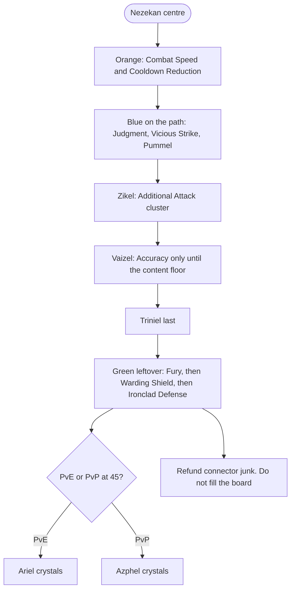

# Templar Skills and Stigmas

> **In one sentence:** the Templar's whole kit is one cooldown loop — Warding
> Strike comes off cooldown, which enables Judgment, which is where the damage
> is — so every skill level, every specialisation pick and every stigma point
> is evaluated by whether it makes that loop tighter, and at Season 1 you are
> doing it with four stigma slots instead of the six every Korean guide assumes.

## Why it matters

Skill investment is the densest Combat Power in the game and it is also the
cheapest, because Skill Points and Daevanion Crystals come from content you
are running anyway. One stigma from level 1 to 20 is worth 10,000 to 15,000
Combat Power; one active or passive from level 1 to 10 is worth 1,000 to
3,000. Nothing in [[Templar Gear and Slots]] competes with that per hour
spent.

It is also the area where Korean guides are least transferable, for one
concrete reason: **KR launched with four stigma slots and a stigma level cap
of 20**, gained a fifth slot on 2026-03-25, and gained a sixth slot plus level
25 with Chapter 1 on 2026-07-01. Almost every Korean Templar stigma guide in
circulation was written against five or six slots. This note is written
against four. See [[Stigmas]] and [[Global Launch Differences]].

Mechanics live elsewhere: [[Stigmas]] for the stigma system,
[[Daevanion Boards]] for board structure and crystal costs,
[[Arcana Cards and Types]] for how skill levels are actually purchased.

## Naming caution, read this first

Skill names below are the **live global English client strings** (AION 2 Hub
and Questlog, retrieved 2026-09-17). Korean stays in parentheses so KR guides
still search. The remap from earlier vault translations is in
[[Glossary KR TW EN]] and [[Class Playbooks]]. Three hazards remain:

- **격앙** is the class's key damage passive. Older translators render it as
  Exaltation or Agitation. The live client name is **Fury**.
- **보호의 방패** (Shield of Protection, a **stigma**), **비호의 방패**
  (Warding Shield, a **passive**) and **비호의 일격** (Warding Strike, an
  **active**) are three different skills with confusingly similar Korean
  names, and machine translation collapses them. Getting them mixed up is the
  most common error in English-language Templar content.
- Older English pages still say **Ferocious Strike** for **Vicious Strike**,
  **Opportunity Strike** / **Desperate Flurry** for **Decisive Strike** /
  **Desperate Strike**, and aion2hub's playstyle blurb says **Provoke** for
  the skill the client lists as **Taunt**.

## How the kit works

### The core loop

This is the mechanical heart of the class and it is why Cooldown Reduction
ranks so highly in [[Templar BiS Roadmap]]'s stat priority.

1. **Warding Strike (비호의 일격)** is used on cooldown. Its function in the
   current kit is not its damage or its small heal — it is that using it
   **activates Judgment**.
2. **Judgment (심판)** is the main damage skill. While it is active you spam
   it, interleaved with either Vicious Strike or Pummel. Live client chain
   names on Vicious Strike are `Decisive Strike` and `Desperate Strike`; spec
   5 adds `Threatening Blow`. Pummel chains into `Punishing Strike`.
3. **Punishment (징벌)** is what you press while Judgment is inactive. It
   full-charges in that window.
4. **Flash Rampage (섬광난무)** reduces **all** skill cooldowns by 3 seconds
   on hit, which is what keeps step 1 coming around.
5. **Shield Smite (방패 강타)** contributes cooldown reduction at
   specialisation 4 and MP recovery at specialisation 2 — both essential,
   because the high-end rotation runs out of MP.
6. **Fury (격앙)** procs off blocking and is the passive multiplier sitting
   underneath all of the above. This is why Block is a damage stat on this
   class and nowhere else.

The two named rotations in the Korean community, both built on this loop:

| Rotation | KR | What it is | Measured |
| --- | --- | --- | --- |
| **Vicious-Judgment** | 맹심 | Vicious Strike into Judgment while Judgment is active, Vicious-Pummel when it is not | ~1,051,600 dummy DPS, no MP problems |
| **Pummel-Judgment cancel** | 연심(캔) | Pummel into Judgment with animation cancelling | ~1,054,500 dummy DPS, **and MP hits the floor after a minute** |

They are **0.2% apart**. The Korean tester's own conclusion is that anyone
who is not chasing the absolute ceiling should use 맹심, because the damage is
effectively identical and the MP problem disappears. That is unusually good
news for a global player: the accessible rotation is the correct rotation, and
the macro-driven cancel build is a rounding error you can ignore until you are
optimising.

One requirement that is not optional: **skill queuing (스킬 예약) must be set
to ON.** The Korean board's phrasing is that with it off, the rotation "gets
completely wrecked".

### In-game macro (PvE)

Full setup: [[In-Game Macros and Hotbar Lines#Templar (수호성)]].

**Default for most players — `Vicious Strike` + `Judgment` (맹심):**

| Hotbar column | Stack **bottom → top** (try first → filler) |
| --- | --- |
| Judgment column | **`Judgment`** → **`Warding Strike`** → **`Shield Smite`** |
| Strike column | **`Vicious Strike`** → chain slots as unlocked |

**Macro (2 steps, 10 ms):** Judgment column → Strike column. **Hold Macro + LMB.**

**Ceiling — `Pummel` cancel (연심캔):** [Inven macro share](https://www.inven.co.kr/board/aion2/6438/24397).
RMB column **`Judgment`** → **`Punishment`** → **`Warding Strike`** → **`Shield Smite`**;
second column **`Pummel`** chain. Same MP caveats as above (~0.2% dummy DPS, much
harder sustain).

**Keep manual:** **`Punishment`** buff, **`Flash Rampage`**, **`Shield Rush`**, **`Doom
Shield`** (charge), **`Defiance`**.

### Active skills, target levels and specialisations

Active skills open specialisation slots at levels **8, 12, 16 and 20**.
[[Skills and Mastery Points]] plus a maxed Daevanion board reaches about level
14 on its own, so **16 needs +2 from Arcana or gear and 20 needs +6**. See
[[Arcana Cards and Types]] for the card-and-ring arithmetic.

Specialisation numbering below follows the Korean board's convention: "20
(3,4,5)" means take the skill to level 20 and select specialisations 3, 4 and
5.

| Skill (EN / KR) | Target | Specialisations | What each one buys | Sub-20 fallback |
| --- | --- | --- | --- | --- |
| **Judgment** (심판) | **20** | **(3, 4, 5)** | 3: extra damage on hit. 4: **guaranteed critical** on hit. 5: **cooldown removed entirely** | 3 or 4, plus 5. If sustain is short, swap in spec 1 (30% of damage as lifesteal) |
| **Vicious Strike** (맹렬한 일격) | **20** | **(3, 4, 5)** | 3: +50% multi-hit on hit. 4: **Warding Strike cooldown −1s** on hit — this is what feeds the loop. 5: a fourth chain hit adds Threatening Blow (위협의 맹타). Live chain partners: Decisive Strike, Desperate Strike | (4, 5). The alternative (2, 4, 5) trades the multi-hit for lifesteal and is the better pick if you are dying |
| **Pummel** (연속난타) | **20** | **(2, 3, 4)** or **(2 or 3, 4, 5)** | 2: Punishing Strike does 15% lifesteal. 3: up to +12% damage the fewer targets you hit. 4: Punishing Strike on hit → **Punishment cooldown −2s**. 5: one extra Punishing Strike activation | 2 or 3, plus 4. **(2,3,4) raises Judgment frequency; (2/3,4,5) raises Punishment cooldown reduction** — pick by which half of the loop is starved |
| **Punishment** (징벌) — as a buff | **12+** | (3, 4) | 3: +30% skill speed. 4: becomes usable while moving. Used for the **Punishment buff**: **Accuracy 200 and Damage Amplification 10% for 10 seconds** | — |
| **Punishment** (징벌) — as a damage skill | **20** | **(2, 3, 5)** | 2: damage over time on hit. 3: +30% skill speed. 5: **ignores Block and Evasion and lands as a critical** | 2 or 5, plus 3 |
| **Annihilate** (섬멸) | **20**, optional | **(1, 3, 4)** | 1: +50% multi-hit. 3: **+50% damage against targets immune to incapacitation** — i.e. bosses. 4: cooldown −10s | (3, 4). Required for a ceiling build; many Korean players skip it because the cast feels bad |
| **Flash Rampage** (섬광난무) | **16 minimum** | — | On hit, **all** skill cooldowns −3s. The single most load-bearing utility skill in the kit | Do not take below 16 |
| **Shield Smite** (방패 강타) | as available | **spec 2 and spec 4** | 4: cooldown reduction, which feeds Judgment activation. 2: MP recovery, which is what makes the rotation sustainable | Both are described as essential |
| **Warding Strike** (비호의 일격) | as available | prefer **PvE Damage Tolerance** over the healing spec | Must be pressed every cooldown or Judgment never activates. Its healing is described as negligible | — |
| **Shield Rush** (방패 돌격) | 12–14 | (1, 2), (1, 4) or (2, 4) | Specialisation 1 has high value. Range +10m; usable after a dash; also a stun. It is your gap-closer and your engage | Take spec 1 and one other; the board calls it taste |
| **Debilitating Smash** (쇠약의 맹타) | low | — | A large **party** damage boost. The Korean board describes it as roughly a 40% party damage increase, which I could not corroborate and record as **low confidence** and possibly a defence debuff rather than an amplification | — |
| **Defiance** (충격 해제) | low | **not spec 1** in PvE | Gives a 7-second status-effect resistance window, which lets you stand and cast through a mechanic. Specialisation 1 makes it a mobility trigger, which is worse in PvE | — |

### Passives

Passives are the quiet answer to "where does the last 10% come from", and the
current Korean Arcana meta is built around them — see the skill-levelling
argument in [[Arcana Sets and Meta]]. A class's tier-one passives multiply
everything, so a level on one is worth more than the fourth specialisation
slot on a minor active.

For a Templar, in priority order:

1. **Fury (격앙)** — the block-triggered damage passive. Max it. It is the
   reason the whole build exists.
2. **Warding Shield (비호의 방패)** — the defensive passive paired with the
   Warding Strike active.
3. **Ironclad Defense (철벽 방어)** — live client name. Korean boards treat
   this as the Iron Wall (철벽) proc that halves incoming damage; the aion2pb
   tooltip reads Defense and Endurance. Iron Wall also appears as a Marchutan
   board option and a pet understanding option, so this compounds either way.
4. **Enhance Health** and the HP passives — real, but a curve rather than a
   threshold.
5. **Guarding Seal** — appears in the Korean Arcana Bell recommendations for
   this class.

The rest of the live roster, named so KR-to-English lookup is not guesswork:
`Punishing Benediction` (extra damage proc on hit), `Impact Hit` (Impact-type
chance and Smite), `Insulting Roar` (enmity on block), `Survival Willpower`
(status resist), `Block Pain` (stacks into Resilience / Damage Tolerance).
The client lists **ten Templar passives**; the order above is still the
Korean board's, the names are the global English strings.

**Where passive levels come from:** the Bell and Mirror Arcana slots (passive
only), the Chalice (both), earring soul imprint (earrings carry passives where
rings carry actives), and the **Cloak** soul imprint line, which rolls class
passive-skill levels directly. A Cloak that rolls a Fury level is the best
armor piece a Season 1 Templar can own.

## Stigmas

### The Season 1 constraint

**Four slots. Level cap 20.** Specialisations unlock at stigma levels 5, 10,
15 and 20, and the shard cost is heavily back-loaded — roughly 5 shards to
reach level 5, about 15 cumulative to 10, about 35 to 15 and about 75 to 20.
Medium confidence on those figures, single source. The practical consequence
is that **two stigmas at 20 plus two at 10 is a realistic Season 1 setting**,
not four at 20, and the Korean layouts below reflect that.

Combat Power per stigma band, for budgeting: 1→5 about 900, 5→10 about 2,000,
10→15 about 3,500, 15→20 about 6,000.

### The Templar stigma pool

| Stigma (EN / KR) | What it does | PvE verdict | PvP verdict |
| --- | --- | --- | --- |
| **Taunt** (도발) | Aggro | **Mandatory. Specialisation 4 is required** — that is what makes uptime continuous instead of periodic | Not recommended, though it occasionally lands and makes an opponent useless |
| **Shield of Protection** (보호의 방패) | Block-based protection | Central to the class's identity but **conditional**: at full HP a blocked hit does nothing anyway, so used alone it is weak. It needs Noble Armor to pay off | Same conditionality — without Noble Armor you do not feel it |
| **Empyrean Lord's Punishment** (주신의 징벌) | Ranged damage, shaves 50 groggy, stuns | **Best cost-efficiency in the pool.** After the Punishment buff you no longer need its specialisation 3 damage amplification, so **10 points is enough** for the groggy contribution | Specialisation 4 adds stun chance; good ranged poke |
| **Comrade in Arms** (전우 보호) | Party protection | **Top-grade for party play. Specialisation 4 is mandatory** or the skill underperforms | Also top-grade |
| **Noble Armor** (고결의 갑주) | Defensive armor buff | Strong, and the enabler for Shield of Protection. Wants 20 points | Strong |
| **Second Skin** (이중 갑옷) | Defensive armor buff | The solo pick — take it instead of Comrade in Arms when you are not in a fixed party | Good |
| **Armor of Balance** (균형의 갑옷) | Defensive armor buff | — | Solo PvP alternative |
| **Capture** (나포) | Grab / pull | Decent for mob-pulling, and at specialisation 5 it gains a stun that is **100% against NPCs** | PvP tool |
| **Nezekan's Shield** (네자칸의 방패) | Damage barrier | **Not recommended.** Once the barrier breaks, specialisations 1–3 are dead, and barrier-breaking skills are now common. Specialisation 4's 20% HP recovery is a downgrade from Comrade in Arms | Not recommended |
| **Doom Shield** (파멸의 방패) | Offensive shield skill | Flexible pick, added to the Korean board's list in the April 2026 revision | — |
| **Battlefield Banner** (전장의 깃발) | Party ground effect | Flexible pick, same revision | — |

### Season 1 four-slot stigma builds

These are the Korean board's own **low-point** layouts, which is exactly the
budget a Season 1 Templar has, adapted to four slots.

**PvE main tank in a party — the default:**

| Slot | Stigma | Points |
| --- | --- | --- |
| 1 | **Taunt** | **20** |
| 2 | **Comrade in Arms** | **15–20** |
| 3 | **Shield of Protection** | **10** |
| 4 | **Empyrean Lord's Punishment** | **10** |

**PvE solo, off-tank or unfixed parties:** identical, but swap Comrade in Arms for **Second Skin** at 15–20. Comrade in Arms's value is
entirely in protecting other people, so it is dead weight when you are alone.

**PvP:**

| Slot | Stigma | Points |
| --- | --- | --- |
| 1 | **Comrade in Arms** | **20** |
| 2 | **Noble Armor** | **20** |
| 3 | **Shield of Protection** | **20** |
| 4 | **Second Skin** | **20** |

Without a party, drop Comrade in Arms for **Capture** or **Armor of Balance**. Note that Taunt is absent from the PvP build entirely.

### The four-slot tension, named

With five or six slots the Korean answer is Taunt 20 → Noble Armor 20 →
Shield of Protection 20 → Empyrean Lord's Punishment 10–20, with Comrade in Arms
alongside. At four slots you cannot have Taunt, Noble Armor, Shield of
Protection **and** a party stigma at once, and Shield of Protection is
explicitly weak without Noble Armor.

The three ways out, in descending order of how much I like them:

1. **Accept Shield of Protection at 10 as a placeholder** and take Comrade in Arms instead of Noble Armor. This is the layout above. You lose
   Shield of Protection's ceiling and keep the party utility that makes a
   Templar worth inviting.
2. **Drop Shield of Protection entirely** and run Taunt 20 / Noble Armor 20 /
   Comrade in Arms 20 / Empyrean Lord's Punishment 10. Defensively the strongest
   four-slot PvE build; you give up a signature skill.
3. **Maintain two stigma presets.** Stigma presets were added to KR on
   2026-01-07, so whether they exist at global launch is unverified. If they
   do, keeping a PvE and a PvP set is cheap in time and expensive only in
   shards.

**This whole section is the most likely thing in these four notes to be
invalidated on day one.** If global ships with five slots, option 1's
compromise disappears and you simply add Noble Armor.

## Daevanion boards

At Season 1 the board roster should be the four launch boards — **Nezekan,
Zikel, Vaizel and Triniel**. The Marchutan board arrived on KR 2026-02-25 and
the Yustiel board on 2026-04-08, so both should be absent. Each launch board
runs roughly 210 points; Marchutan, for scale, needs over 230 for over 150
item level, so four boards is very roughly 840 points and 840 item level.
Every crystal point spent is **+1 item level** on top of the node's stats,
which makes the boards the cheapest item level available at any stage.

### Node stat priority for a PvE Templar

From the Korean Guardian board:

**Additional Attack > Defense > HP > Critical > Critical Resist > MP**

The specific instruction is to **prioritise the Additional Attack nodes**
(the board post quotes 82 of them) and to prune the connector nodes you do
not need rather than filling the board evenly. Boards are laid out so that
reaching a valuable node requires passing through cheaper ones; the skill is
in routing, not in completion.

Two Templar-specific reads on that list:

- **Additional Attack first, on a tank, is correct** for the same reason
  Accuracy is: aggro is damage-derived, and tank damage feeds the clear timer.
- **Defense above HP is the board's own ranking, and it conflicts** with the
  Korean Guardian board's separate argument that flat Defense is nearly
  meaningless in PvE next to Damage Resistance. If Damage Resistance nodes
  exist on these boards, take them over Defense. I could not confirm the full
  node stat list per board, so this is a judgement call rather than a sourced
  one.

### Board routing order

**Nezekan → Zikel → Vaizel → Triniel.**

Read against the Empyrean Lord conversions in [[Stat Reference]], that order
makes sense for a Templar: Nezekan is Justice (Defense and Perfect chance),
Zikel is Destruction (Attack Power), Vaizel is Freedom (Accuracy and
Evasion), Triniel is Death (Critical and Regeneration Penetration). Justice
first for the tank floor, Destruction second for the damage the aggro depends
on, then Accuracy toward the threshold, then Critical last as the pure curve.

Note that the boards also carry **Iron Wall / Regeneration** option types, at
least on Marchutan, and **Ironclad Defense** is a Templar passive as well. If
the launch boards carry Iron Wall nodes, they are worth more to this class than
the generic priority list implies.

*Confidence: medium.* The stat priority and routing order are single-source
from the Korean Guardian board, and which specific boards exist at Season 1 is
inferred from the KR patch chronology rather than confirmed.

How a Templar actually walks a board. Universal colour rules and the F-key
preview are in [[Daevanion Boards]].

## The levelling build

Levels 1 to 45, plus the first Conquest weeks. The goal is a functioning loop
and nothing else — do not spread Skill Points thin trying to hit target
levels you cannot reach yet.

**Skill Points and Daevanion Crystals go to, in order:**

1. **Vicious Strike** — your basic attack and the skill that shortens Warding
   Strike's cooldown. Take specialisations 4 and 5 as they unlock. If you are
   dying to trash, take 2 instead of 3 for the lifesteal.
2. **Judgment** — take 3 or 4, and 5 as soon as level 20 is even conceivable.
   Below 20 use spec 1's 30% lifesteal if you have no healer.
3. **Pummel** — 2 or 3, plus 4.
4. **Flash Rampage** to 16. Nothing else in the kit does what this does.
5. **Warding Strike** and **Shield Smite** — no level target, but take the
   cooldown and MP specialisations, because the loop stops without them.
6. **Punishment to 12** and use it as the Punishment buff (Accuracy 200,
   Damage Amplification 10%, 10 seconds). At level 12 with specialisations 3
   and 4 it is a movement-friendly buff, which is what you want while
   levelling.
7. **Fury**, **Warding Shield** and **Ironclad Defense** as passive points
   allow.
8. **Shield Rush** to 12 with specialisation 1, for the mobility.

**Do not yet:** take Annihilate, chase level 20 on anything, or spend Arcana
lines on minor actives. Annihilate is a ceiling skill and it feels bad at low
specialisation.

**Levelling rotation:** left-click Vicious Strike, press Warding Strike every
time it is up, press Judgment whenever it is active, hold Punishment for the
buff window, and use Flash Rampage as your cooldown reset. That is the whole
game until level 45.

## The endgame build

Season 1 endgame, four stigma slots, stigma cap 20, five Arcana slots.

**Actives:**

| Skill | Level | Specialisations |
| --- | --- | --- |
| Judgment | 20 | 3, 4, 5 |
| Vicious Strike | 20 | 3, 4, 5 |
| Pummel | 20 | 2, 3, 4 (Judgment-frequency variant) |
| Punishment | 20 | 2, 3, 5 (damage variant) — or hold a 12-point buff variant on a second preset |
| Annihilate | 20 | 1, 3, 4 |
| Flash Rampage | 16+ | — |
| Shield Smite | as high as points allow | 2, 4 |
| Warding Strike | as high as points allow | PvE Damage Tolerance |
| Shield Rush | 12–14 | 1 plus one |
| Defiance | low | anything except 1 |

**Passives:** Fury maxed first, then Warding Shield, then Ironclad Defense.

**Stigmas:** Taunt 20 / Comrade in Arms 20 / Shield of Protection 10 /
Empyrean Lord's Punishment 10.

**Skill levels come from:** Parchment and Compass Arcana for two or three
actives at 20 (small pools of six skills each, so they can actually be
aimed), the Chalice to close the gaps and add three or more **passive** lines,
rings for active levels and earrings for passive levels. A common pattern is
Parchment 4 + Ring 1 + Ring 1 = level 20 on one skill.

**Rotation:** Vicious-Judgment (맹심). Skill queuing ON. Interleave Vicious
Strike with Judgment while Judgment is active; when it drops, Vicious-Pummel
until Warding Strike comes back and re-enables it; full-charge Punishment in
the dead window. The Pummel-cancel variant is 0.2% better and costs you your
MP bar — take it only if you have the MP passives, the Magic Armor Arcana
2-piece, and a reason.

**How to tell if the build is working:** Fury should be up essentially all
the time. If it is flickering, the answer is Block, not more Attack — go read
the Block sources in [[Templar Support Systems]].

## Costs and math

- Specialisation slots at skill levels 8, 12, 16 and 20. Base progression
  plus a maxed Daevanion board reaches about 14, so 16 needs +2 and 20 needs
  +6 from Arcana, rings and earrings.
- Stigma shard costs, cumulative and **medium confidence**: about 5 to reach
  level 5, about 15 to level 10, about 35 to level 15, about 75 to level 20.
  Specialisations at 5, 10, 15 and 20.
- Stigma Combat Power: 1→5 about 900, 5→10 about 2,000, 10→15 about 3,500,
  15→20 about 6,000. One stigma from 1 to 20 is 10,000 to 15,000 CP total.
- One active or passive from level 1 to 10 is 1,000 to 3,000 CP.
- Four Daevanion boards at roughly 210 points each is roughly 840 points and
  therefore roughly 840 item level. Marchutan, for calibration, was over 230
  points for over 150 item level.
- Measured rotation DPS on a KR mid-2026 patch: 1,054,534 for
  Pummel-Judgment against 1,051,644 for Vicious-Judgment, ten-run averages on
  a training dummy. Hits per minute 531 against 491; Judgment hits per minute
  150 against 197. These are **Chapter 1-era gear numbers** and are useful
  only for the *relative* comparison.
- The Korean board's stated ceiling for a top-spec Guardian on the same patch
  is roughly 7.5 to 7.8 million dummy DPS, which tells you how far the
  headroom runs once gear catches up. Not a Season 1 number.

## Traps and mistakes

- **Reading a Korean stigma guide without checking the slot count.** Stated
  three times in these notes for a reason.
- **Confusing Shield of Protection (stigma), Warding Shield (passive) and
  Warding Strike (active).** Machine translation collapses all three.
- **Leaving skill queuing off.** The Korean board's word is that the rotation
  "gets completely wrecked".
- **Chasing the Pummel-cancel rotation early.** It is 0.2% better and it
  empties your MP bar in one minute. Use Vicious-Judgment.
- **Pushing a minor active to level 20 because it raises Combat Power.**
  Korean guides describe this bluntly as inflating your rating for show. A
  skill contributing 1–2% of your damage gains nothing real from 19 to 20; a
  tier-one passive level multiplies everything.
- **Matching a level-3 or level-4 Arcana line to a skill that will finish at
  16.** Match it to 2 and spend the rest elsewhere.
- **Taking Nezekan's Shield.** Barrier-breaking skills are common enough that
  its first three specialisations are dead weight.
- **Filling a Daevanion board evenly.** Route to the nodes you want and prune
  the connectors.
- **Not pressing Warding Strike on cooldown.** It is not a heal and it is not
  filler; it is the gate on your main damage skill.
- **Taking Defiance specialisation 1 in PvE.** It converts a
  stand-and-cast window into a mobility trigger, which is the opposite of
  what you want against a boss.

## Global launch notes

Rank-ordered by how much a wrong guess costs you:

1. **Stigma slots and level cap.** Four and 20 are inferred from the KR patch
   chronology. Confirm in the stigma UI on day one; if it is five slots, add
   Noble Armor at 20 and the four-slot tension resolves itself.
2. **Whether Fury exists and how it triggers.** Perfect Block arrived in KR on
   2026-03-25, so the launch build's block interaction is simpler than
   anything the current Korean board describes. If Fury requires Perfect
   Block, the entire Block-as-damage-stat argument changes.
3. **Which Daevanion boards ship.** Four general boards plus Azphel in the
   Launch Scale Test; **Ariel was missing.** If Marchutan is present later, its
   Iron Wall and Weapon Damage Amplification options are strong for this class.
4. **Whether stigma and skill-mastery presets exist.** Added to KR
   2026-01-07.
5. **The 2026-08-26 class rework**, described by [[Global Launch Differences]]
   as the largest since Chapter 1, post-dates everything a global player
   will see. Some of the specialisation picks above — particularly the
   Punishment buff-versus-damage split, which the Korean board revised after a
   Punishment buff patch — reflect the reworked kit and may be wrong for the
   launch version.

## Open questions

- [ ] Does Fury (격앙) exist in the launch build, what is its exact trigger,
      and what does it multiply? Nothing in the Season 1-dated Korean posts I
      found describes it in mechanical detail.
- [ ] Which passives the Cloak soul imprint line can roll, and whether Fury is
      among them.
- [ ] Whether Debilitating Smash's party effect is a Damage Amplification buff
      or a defence debuff, and whether the ~40% figure is real. This changes
      whether it stacks with a Chanter's buffs — see [[Chanter BiS Roadmap]].
- [ ] The full node stat list per launch Daevanion board, and specifically
      whether Damage Resistance nodes exist. The board priority list says
      Defense above HP but the same community argues Defense is weak in PvE.
- [ ] The exact stigma shard cost curve. My figures are single-source.
- [ ] Whether the pre-2026-08-26 kit differs enough from the current one that
      the specialisation picks above are wrong for a Season 1 client.
- [ ] Whether the Templar's stigma pool at Season 1 contains all eleven
      stigmas listed above, or whether Doom Shield and Battlefield Banner
      are later additions. The Korean board added both in an April 2026
      revision, which is suggestive.

## Sources

- [AION 2 Hub — Templar](https://aion2hub.com/classes/templar) — live global client skill list, retrieved 2026-09-17. Source of every English skill name in this note, including Vicious Strike / Decisive Strike / Desperate Strike, Punishing Strike, Ironclad Defense, Debilitating Smash, Shield Rush, Empyrean Lord's Punishment, Comrade in Arms, Second Skin, Doom Shield, Defiance, Threatening Blow, Armor of Balance, Taunt and Fury.
- [AION 2 PB — Templar](https://aion2pb.com/articles/Templar) — EN class page, retrieved 2026-09-17. Cross-check of passives and stigmas. Older copy on this site still says Ferocious Strike / Opportunity Strike / Desperate Flurry for Vicious Strike / Decisive Strike / Desperate Strike.
- [수호성 스킬 정리(PVE)](https://www.inven.co.kr/board/aion2/6438/6625) — KR, Inven Guardian board, revised 2026-04-09, read 2026-09-06. **The backbone of this note.** Every specialisation pick and target level in the actives table: Vicious Strike 20 (3,4,5), Pummel 20 (2,3,4) or (2/3,4,5) with the Judgment-frequency versus Punishment-cooldown tradeoff, Judgment 20 (3,4,5) with the spec-1 lifesteal fallback, the Punishment buff-versus-damage split at 12 and 20, Annihilate 20 (1,3,4), and every sub-20 fallback. Also the note that this revision added Battlefield Banner and Doom Shield to the stigma list.
- [수호성pvp/pve 스티그마 선택가이드](https://www.inven.co.kr/board/aion2/6438/7621) — KR, Inven Guardian board, read 2026-09-06. Every stigma verdict in the pool table, and the point layouts the Season 1 builds are adapted from — including the **four-stigma low-point layout** (Taunt 20 → Second Skin or Comrade in Arms 15–20 → Shield of Protection 10 → Empyrean Lord's Punishment 10) and the PvP all-in layout. Also the specific reasoning that Shield of Protection is weak without Noble Armor and that Nezekan's Shield is dead once the barrier breaks.
- [수호성 스킬 세팅 + 인게임 매크로 공유 (연심캔)](https://www.inven.co.kr/board/aion2/6438/24397) — KR, Inven Guardian board, 2026-09, read 2026-09-06. Warding Strike's role as the Judgment gate and the recommendation to take PvE Damage Tolerance over its healing spec; Shield Rush's 12/14/24 options with spec 1's high value; Annihilate as mandatory in a ceiling build; Defiance's 7-second status-resist window and the warning against spec 1 in PvE; the Vicious Strike 245-versus-345 lifesteal-versus-multi-hit argument.
- [부캐 수호 연(맹)심 vs 맹(연)심 비교](https://www.inven.co.kr/board/aion2/6438/25720) — KR, Inven Guardian board, 2026-09-04. The ten-run averaged rotation comparison: 1,054,534 against 1,051,644 DPS, 531 against 491 hits per minute, 150 against 197 Judgment hits, the MP-floor caveat on the cancel rotation, and the author's own conclusion that most players should use Vicious-Judgment.
- [현재 수호 최고점 연(맹)심 셋팅 공유(수정)](https://www.inven.co.kr/board/aion2/6438/25722) — KR, Inven Guardian board, 2026-09-04. The 7.5–7.8 million dummy DPS ceiling, the Judgment/Annihilate keybind line requirement, and the **skill queuing must be ON** instruction.
- [25.11.22 수호성 세팅 공유](https://www.inven.co.kr/board/aion2/6438/166) — KR, Inven Guardian board, 2025-11-22. One of the few **Season 1-dated** Templar posts: Shield Rush's +10m range and post-dash stun, Capture's 100% NPC stun at level 5 and its use for mob-pulling, and Empyrean Lord's Punishment as a 50-groggy ranged stun.
- [수호성 스킬 우선순위 thread](https://www.inven.co.kr/board/aion2/6438/4501) — KR, Inven Guardian board, read 2026-09-06 via search extract. The level-20 target list (Vicious Strike, Pummel, Judgment, Punishment) and the level-16 target list (Flash Rampage, Shield Smite, Annihilate).
- [수호성 세팅 / 스탯 우선순위 thread](https://www.inven.co.kr/board/aion2/6438/22782) — KR, Inven Guardian board, 2026, read 2026-09-06 **via search-result extract only**; direct fetch returned 404 so the URL may have shifted. Source of the Daevanion stat priority (Additional Attack > Defense > HP > Critical > Critical Resist > MP), the "82 Additional Attack nodes" and prune-the-connectors advice, the Nezekan → Zikel → Vaizel → Triniel routing order, the ~210 points per board figure, the Flash Rampage 3-second cooldown reduction, the Shield Smite spec 2 and 4 requirement, and the Debilitating Smash party-damage claim. **Medium confidence throughout** because it could not be re-fetched.
- [(스압)개인적인 pve 수호성 스킬 특화 및 스티그마 세팅](https://www.inven.co.kr/board/aion2/6438/12045) — KR, Inven Guardian board. The argument that flat Defense is nearly meaningless in PvE next to Damage Resistance, which is why the Daevanion board's Defense-above-HP ranking is flagged as conflicting.
- [아이온2 인벤 : 아르카나 액티브가 아니라 패시브](https://www.inven.co.kr/board/aion2/6452/21640) — KR, Inven Cleric board, 2026. The passive-first Arcana rule and the argument against pushing minor actives to 20 for Combat Power, applied here to the Templar passive priority list.
- [AION2 Hub — patch note archive](https://aion2hub.com/updates) — KR notes in translation, read 2026-09-06. The stigma slot chronology (KR launch 4 slots and cap 20; fifth slot 2026-03-25; sixth slot and cap 25 on 2026-07-01), the Marchutan board on 2026-02-25 and Yustiel on 2026-04-08, stigma and skill-mastery presets on 2026-01-07, Perfect Block on 2026-03-25, and the 2026-08-26 class rework.
- [AION 2 build planner — Templar](https://aion2hub.com/builds/templar/templar-pve-tank-6znwtf) — KR data via a global fan site, read 2026-09-06. Used to confirm which skills carry specialisation slots. Treated as a build-structure reference, not as a naming source; names come from the Hub class page above.

## Related notes

[[Templar BiS Roadmap]] · [[Templar Gear and Slots]] ·
[[Templar Support Systems]] · [[In-Game Macros and Hotbar Lines]] ·
[[Chanter BiS Roadmap]] · [[Stigmas]] ·
[[Daevanion Boards]] · [[Skills and Talents]] ·
[[Skills and Mastery Points]] · [[Arcana Cards and Types]] ·
[[Arcana Sets and Meta]] · [[Stat Reference]] ·
[[Soul Imprint and Soul Binding]] · [[Item Level vs Combat Power]] ·
[[Global Launch Differences]] · [[Home]]
