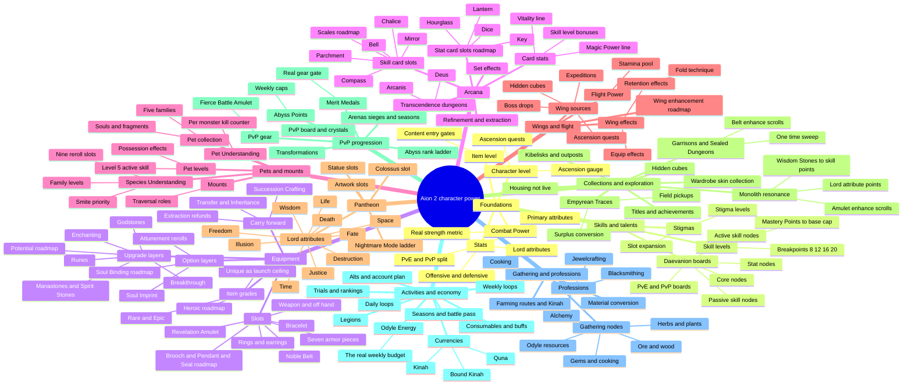
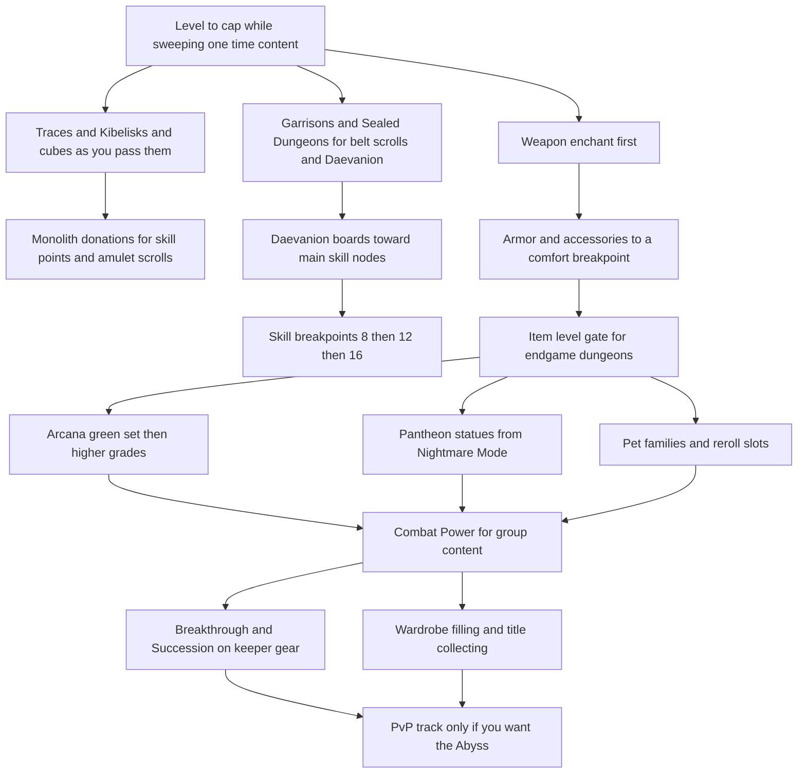
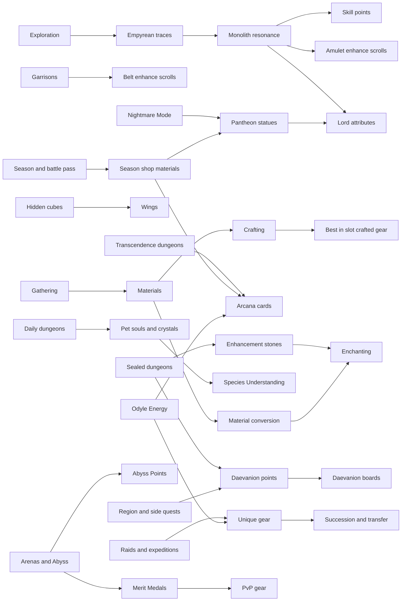

# Progression Mindmap

Three views of the same thing: the full map of progression types, the order to
invest in them, and which activity feeds which system. The clickable version is
the Obsidian canvas `Progression Mindmap.canvas`, where every box opens its note.

If the diagrams render as plain code, your Obsidian predates Mermaid mindmap
support; use the canvas instead, or update Obsidian.

Everything below is scoped to the Season 1 global launch baseline: gate range 0
to about 3,800 and no Heroic-grade equipment. Branches marked *roadmap* exist in
Korea today but are not expected at launch.

## 1. Every progression type

## 2. Order of investment

The reasoning behind this ordering lives in [[Progression Phases Roadmap]], and
the class-specific version in [[Templar BiS Roadmap]],
[[Chanter BiS Roadmap]] and [[Cleric BiS Roadmap]].

## 3. What feeds what

Work backwards from the system you want to progress to the activity that pays
for it. The gating resource is usually Odyle Energy rather than entries, so see
[[Odyle Energy and Entry Limits]] before planning a week.

## Related

- [[Home]]
- [[Progression Phases Roadmap]]
- [[Season 1 Launch Plan]]
- [[Item Level vs Combat Power]]
- [[Glossary KR TW EN]]
